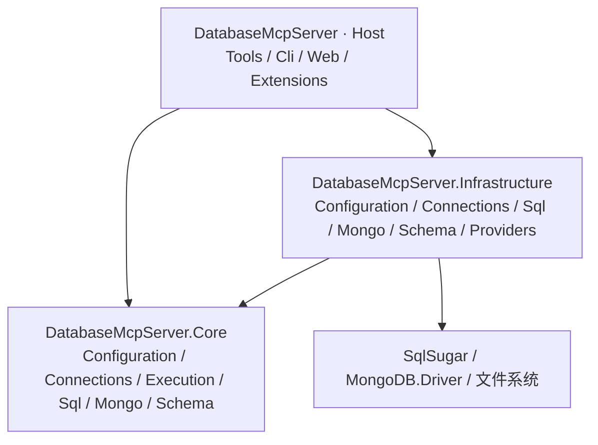
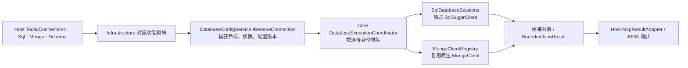

# 后端模块边界

本次迁移保持一个进程和一个 .NET 工具包，拆为三个生产程序集。62 个 MCP 工具的名称、参数与 JSON 契约保持不变，源码和测试继续支持 .NET 9 / 10，发布包仅包含 .NET 10。



| 模块 | 职责 | 依赖约束 |
| --- | --- | --- |
| Host | MCP SDK、工具说明、参数绑定、CLI/Web 输出、应用组装 | 可以引用 Core / Infrastructure；工具类只适配应用操作 |
| Core | 配置及结果契约、不可变操作快照、权限策略、执行准入、元数据缓存 | 无 NuGet 依赖；不引用驱动、MCP 或 Host |
| Infrastructure | SQL / Mongo 操作、错误分类、驱动设置、客户端生命周期、配置文件读写与应用 | 引用 Core；不引用 Host / MCP / CLI / Web |

`ArchitectureBoundaryTests.Assemblies_EnforceCoreAndInfrastructureDependencyDirection` 检查实际程序集引用，避免后续功能重新把 SDK 或数据库驱动带入 Core。

## 按功能查找代码

每个项目内部按功能组织。同一功能的 DTO、接口、实现放在所属模块内，不再汇集到项目级 `Models / Interfaces / Helpers / Services / Operations`。本轮只调整物理路径，类型仍在原程序集，现有命名空间保留；没有新增转发类型或兼容层。

| 功能 | Core | Infrastructure | Host / 测试 |
| --- | --- | --- | --- |
| 配置文件及编辑 | `Configuration`：配置模型、编辑结果、摘要 | `Configuration`：编辑与校验；`Persistence`：文件读写；`Runtime`：加载、监听、发布 | `Cli`、`Web` / `Configuration` |
| 数据库连接 | `Connections`：连接定义、更新、选择状态契约、脱敏 | `Connections`：连接操作、探测、当前选择存储、连接串构造 | `Tools/Connections` / `Connections` |
| 执行控制 | `Execution`：快照、预留、租约、准入、权限和超时策略 | `Execution`：通用操作执行 | `Execution` 测试 |
| SQL | `Sql`：命令、参数、查询结果 | `Sql/Clients`、`Queries`、`Commands`、`Parameters`、`Safety`；SQL 共用执行器位于 `Sql` | `Tools/Sql` / `Sql` |
| Mongo 集合 | `Mongo`：集合结果契约 | `Mongo`：原生客户端、集合操作、文档校验和错误分类 | `Tools/Mongo` / `Mongo` |
| 数据库结构 | `Schema`：元数据缓存 | `Schema`：结构操作、列定义解析 | `Tools/Schema` / `Schema` |
| 数据库适配 | — | `Providers`：目录、能力、预设、策略契约及工厂；各数据库策略进入对应子目录 | `Providers` 测试 |
| 结果与诊断 | `Results`：结果、错误和 JSON；`Diagnostics`：指标 | `Results`：数据库错误映射 | `Serialization`、`Tools/McpResultAdapter.cs` |

例如，修改查询参数处理时查看 `Core/Sql/DatabaseParameter.cs` 和 `Infrastructure/Sql/Parameters/SqlParameterBinder.cs`；修改配置热加载时查看两层的 `Configuration/Runtime`。表中 Core / Infrastructure 对应 `src/DatabaseMcpServer.Core` / `src/DatabaseMcpServer.Infrastructure`。

测试项目采用相同功能分组，另外保留 `Architecture`、`Mcp`、`Cli`、`Web`、`Serialization`。共享测试辅助类集中在 `Support`；真实数据库集成测试位于 `Integration/Sql` 和 `Integration/Mongo`。测试命名空间及 Trait 保持原值，现有测试筛选命令继续有效。

## 请求执行



- 排队前固定连接快照；连接重命名继续使用原准入身份。SQL 和 Mongo 使用同一准入机制，Mongo 集合操作无需 SQL 工厂。
- SQL 操作通过 `SqlOperationExecutor` 复用权限、超时、错误和元数据失效规则；连接管理使用中立的 `DatabaseOperationExecutor`，不继承 SQL 客户端逻辑。
- `SqlSugarConnectionSettings` 为真实执行和离线能力报告生成同一套 ORM 配置。能力报告不创建 SQL 客户端。
- 普通操作返回对象，Host 输出 JSON；有字节预算的查询返回 `BoundedJsonResult`，保留已编码的 UTF-8 内容。协议中的 text / structuredContent 仍会增加封装开销。
- MCP、CLI 和 Web 共享 `ToolCatalog`。确认规则通过工具方法的 `ToolPolicyAttribute` 声明；Web 直接绑定 JSON，不再经过 CLI 字符串转换。

## 配置写入与运行时

`ConfigurationFileStore` 管理文件；`ConfigurationCommands` 服务 CLI/Web 配置操作；`DatabaseConfigurationApplicationService` 统一连接编辑的校验及原子写入。`DatabaseConfigService` 维护最近有效运行快照，`ConfigurationRuntimeApplier` 负责保存后的重新应用。

文件保存、运行时发布、当前选择持久化分别报告 `saved`、`runtimeApplied`、`selectionPersisted`。首次初始化允许空配置，运行时按需解析；重载失败保留最近有效快照。在线连通性诊断共享运行时准入，独立 CLI 命令拥有自己的执行生命周期。

## 开发与发布

从仓库根目录执行：

```powershell
dotnet build 'DatabaseMcpServer.slnx' -c 'Release'
dotnet test 'DatabaseMcpServer.slnx' -c 'Release' --no-build --filter 'Category!=Integration&Category!=MongoIntegration'
pwsh -NoProfile -File 'scripts/test-integration.ps1'
pwsh -NoProfile -File 'scripts/test-mongodb-integration.ps1'
pwsh -NoProfile -File 'scripts/verify-cli-tools.ps1' -Framework 'net10.0' -Configuration 'Release'
pwsh -NoProfile -File 'scripts/test-package.ps1'
```

普通后端构建不运行 npm，使用仓库中的 `website/dist`。修改前端或制作发布包时显式构建资产：

```powershell
dotnet build 'src/DatabaseMcpServer/DatabaseMcpServer.csproj' '-p:BuildWebsite=true'
dotnet pack 'src/DatabaseMcpServer/DatabaseMcpServer.csproj' -c 'Release' '-p:TargetFrameworks=net10.0' '-p:BuildWebsite=true' --artifacts-path 'artifacts/package-build'
```

发布工作流和安装包验证脚本均已启用 `BuildWebsite=true`，并使用独立构建目录还原 net10 依赖。双框架构建后不能直接用 `--no-restore` 打单框架包，否则 nuspec 可能残留 net9 依赖组。`scripts/verify-package-content.ps1` 在本地验证和发布前统一检查：没有 NuGet 依赖声明、框架仅 net10、Core / Infrastructure DLL、62 工具目录和原生驱动资产；安装测试再验证 CLI / stdio。不单独发布两个类库。

本次重点是依赖边界和维护成本，没有重新测量吞吐提升。现有查询预算、危险操作保护、取消等待驱动退出、SQL 独立客户端和 Mongo 写入结果未知的语义继续适用。

本轮双框架各通过 449 项非容器回归、38 项 SQL 集成和 10 项 Mongo 集成。详细验收记录及本地日志位置见 [实施计划](../plans/2026-11-20-backend-modularization.md)。
