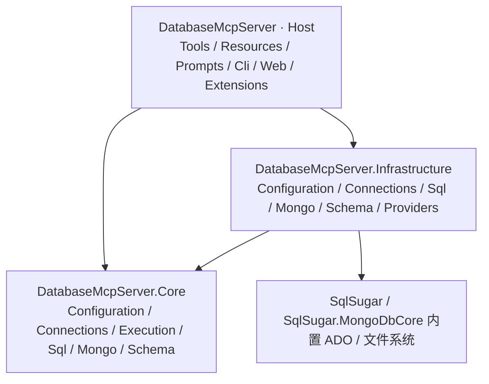
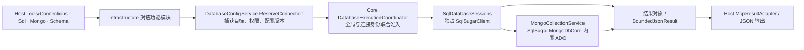
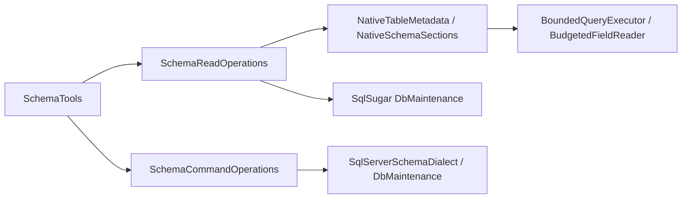
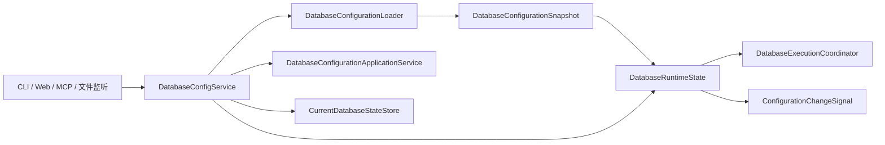
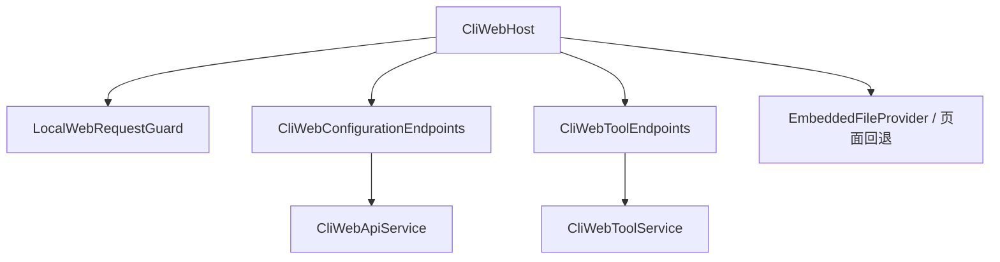

# 后端模块边界

项目以一个进程和一个 .NET 工具包运行，包含三个生产程序集。当前源码静态目录有 54 项工具。Host 的 `ToolCatalog` 提供 MCP、CLI 和 Web 元数据，`ToolExposurePolicy` 控制工具发现和调用。Infrastructure 的 SQL 和 Mongo 服务复用 Core 的准入与权限。详见[工具契约](tool-evolution.md)及[5.0.0 变更](release-5.0.0.md)。



| 模块 | 职责 | 依赖约束 |
| --- | --- | --- |
| Host | MCP SDK、工具说明、参数绑定、CLI/Web 输出、应用组装 | 可以引用 Core / Infrastructure；工具类只适配应用操作 |
| Core | 配置及结果契约、不可变操作快照、权限策略、执行准入、元数据缓存 | 无 NuGet 依赖；不引用驱动、MCP 或 Host |
| Infrastructure | SQL / Mongo 操作、错误分类、驱动设置、客户端生命周期、配置文件读写与应用 | 引用 Core；不引用 Host / MCP / CLI / Web |

`ArchitectureBoundaryTests.Assemblies_EnforceCoreAndInfrastructureDependencyDirection` 检查实际程序集引用，避免后续功能重新把 SDK 或数据库驱动带入 Core。

源码、测试、基准和工具包统一使用 .NET 10 LTS。

## 按功能查找代码

每个项目内部按功能组织。同一功能的 DTO、接口、实现放在所属模块内，不再汇集到项目级 `Models / Interfaces / Helpers / Services / Operations`。本轮只调整物理路径，类型仍在原程序集，现有命名空间保留；没有新增转发类型或兼容层。

| 功能 | Core | Infrastructure | Host / 测试 |
| --- | --- | --- | --- |
| 配置文件及编辑 | `Configuration`：配置模型、编辑结果、摘要 | `Configuration`：编辑与校验；`Persistence`：文件读写；`Runtime`：加载、监听、发布 | `Cli`、`Web` / `Configuration` |
| 数据库连接 | `Connections`：连接定义、更新、选择状态契约、脱敏 | `Connections`：连接操作、探测、当前选择存储、连接串构造 | `Tools/Connections` / `Connections` |
| 执行控制 | `Execution`：快照、预留、租约、准入、权限和超时策略 | `Execution`：通用操作执行 | `Execution` 测试 |
| SQL | `Sql`：命令、参数、查询结果 | `Sql/Clients`、`Queries`、`Commands`、`Parameters`、`Safety`；SQL 共用执行器位于 `Sql` | `Tools/Sql` / `Sql` |
| Mongo 集合 | `Mongo`：集合结果契约 | `Mongo`：内置 ADO 集合操作、文档校验和错误分类；客户端复用 `Sql/Clients` | `Tools/Mongo` / `Mongo` |
| 数据库结构 | `Schema`：元数据缓存 | `Schema`：结构操作、列定义解析 | `Tools/Schema` / `Schema` |
| 数据库适配 | — | `Providers`：目录、能力、预设、策略契约及工厂；各数据库策略进入对应子目录 | `Providers` 测试 |
| 结果与诊断 | `Results`：结果、错误和 JSON；`Diagnostics`：指标 | `Results`：数据库错误映射 | `Serialization`、`Tools/McpResultAdapter.cs` |

例如，修改查询参数处理时查看 `Core/Sql/DatabaseParameter.cs` 和 `Infrastructure/Sql/Parameters/SqlParameterBinder.cs`；修改配置热加载时查看两层的 `Configuration/Runtime`。表中 Core / Infrastructure 对应 `src/DatabaseMcpServer.Core` / `src/DatabaseMcpServer.Infrastructure`。

测试项目采用相同功能分组，另外保留 `Architecture`、`Mcp`、`Cli`、`Web`、`Serialization`。共享测试辅助类集中在 `Support`；真实数据库集成测试位于 `Integration/Sql` 和 `Integration/Mongo`。测试命名空间及 Trait 保持原值，现有测试筛选命令继续有效。

## 请求执行



- 排队前固定连接快照；重命名复用准入身份。SQL 和 Mongo 共用 `SqlDatabaseSessions` / `ISqlSugarClientFactory` 租约，没有独立 MongoClient 注册表。协调器联合检查全局/单连接执行及等待额度，选择最早可运行请求，跳过已满连接；同一连接保持入队顺序。取消与分配竞争时归还一次，清理结束前不释放租约。默认总执行 32、总等待 128；不同 Host/进程互不共享。
- 异步 SQL 通过 `SqlRequestExecutor` 统一准入、权限、总 deadline、取消、错误、指标和写后元数据失效。`SqlOperationExecutor` 提供工具操作的对象返回边界，`DatabaseQueryService` 使用相同组件映射结构化错误。原子事务的 commit/rollback/unknown 生命周期独立；同步 GO/DDL 继续使用驱动超时。连接管理使用中立的 `DatabaseOperationExecutor`。
- 请求 token 控制异步 SQL 的总截止时间，返回前使用单调时钟补查到期状态。驱动命令超时延后 1 秒，避免驱动计时粒度导致提前取消。清理完成后释放租赁。
- `SqlSugarConnectionSettings` 为真实执行和离线能力报告生成同一套 ORM 配置。能力报告不创建 SQL 客户端。
- 普通操作返回对象，Host 输出 JSON；有字节预算的查询返回 `BoundedJsonResult`，保留已编码的 UTF-8 内容。协议中的 text / structuredContent 仍会增加封装开销。
- Reader 内部使用 `DatabaseQueryResult<BoundedJsonResult>` / `ExplainQueryResult<BoundedJsonResult>`，复用通过预算检查的 JSON 行；公开的非泛型类型仍描述对象数组 schema。仅游标末行和元数据映射按需解析，避免所有行经过 JSON→字典→JSON。
- `ProviderCapabilities` 定义允许名单、已知排除项及 schema 操作组。参数说明、离线报告、CLI 全目录和[生成的能力文档](capabilities.generated.md)共用声明。能力按配置产品判断，SQL 方言和连接选项由实际驱动决定。
- MCP、CLI 和 Web 共享 `ToolCatalog`。确认规则通过工具方法的 `ToolPolicyAttribute` 声明；Web 直接绑定 JSON，不再经过 CLI 字符串转换。
- Host 的 `Resources/DatabaseResources.cs` 复用连接和结构操作，`Prompts/DatabasePrompts.cs` 提供指导模板；`ServiceCollectionExtensions` 注册资源、Prompt、连接名补全和 ServerInstructions。健康检查通过注入的 IProgress 发布进度，CLI/Web 绑定不把它当作用户参数。
- `query_table_page` 的选列/筛选/排序分支使用 SqlSugar `ToOffsetDataTablePageAsync`，整页物化后检查响应预算；省略这些选项时保留有界 reader 与主键 cursor。`insert_row` 使用字典 Insertable 返回整数自增值，并在写入前检查 provider、普通表名及自增元数据。
- Mongo 的 find 转成只读 aggregate，读取由内置 ADO 先物化再检查响应预算，初始同步查询可能延迟取消。探活也使用有行数限制的内置 aggregate，因为 OpenAsync 本身不执行网络握手。AOP 仅记录事件、耗时及脱敏错误，不记录文档内容。详细限制见[Mongo 契约](mongodb-collections.md)。
- `ToolChoicesDescriptionAttribute` 同时提供参数说明和枚举集合；`ToolInputSchema` 生成 Schema enum，`ToolInvoker` 校验输入，MCP list filter 发布同一 Schema。
- `BudgetedFieldReader` 在结果编码前检查字段预算，`BoundedQueryExecutor` 管理结果预算，查询与导出共用 `QueryRowEncoder`。`SqlSugarReaderAdapter` 为 PostgreSQL 和 SQL Server 的有界读取启用 `SequentialAccess`，`SqlReaderLease` 负责清理命令和 reader。SQL Server 存储过程在读取完整结果后提取输出参数。
- `SchemaReadOperations` 负责元数据、存在性和缓存，`SchemaCommandOperations` 负责 DDL；SQL Server 特有默认值和注释 SQL 集中到 `SqlServerSchemaDialect`，删除旧 `SchemaOperations` facade。SQL Server 表和列注释按 schema 定位，更新调用 `sp_updateextendedproperty`；默认约束替换在事务中完成，避免失败后丢失原值。
- `SchemaReadOperations` 为其他 SQL provider 通过 `DbMaintenance` 读取基础元数据，并在每次同步驱动调用返回后检查取消。能力报告使用配置快照，不打开数据库连接。



## 配置写入与运行时

`ConfigurationFileStore` 管理文件；`ConfigurationCommands` 服务 CLI/Web 配置操作；`DatabaseConfigurationApplicationService` 统一连接编辑的校验及原子写入。`ConfigurationRuntimeApplier` 负责保存后的重新应用。Infrastructure 的 `Configuration/Runtime` 内部分工如下：

| 文件 | 职责 |
| --- | --- |
| `DatabaseConfigService.cs` | 协调启动、切换、重载、编辑和选择持久化；持有重载锁和选择写锁，组装操作结果。 |
| `DatabaseConfigurationLoader.cs` | 解析路径、读取及校验配置、计算内容 hash；编辑后使用已验证候选和保存后文本，不重复解析候选。 |
| `DatabaseConfigurationSnapshot.cs` | 在加载器和运行状态之间传递内部候选；不作为公开响应返回。 |
| `DatabaseRuntimeState.cs` | 独占连接字典、当前/默认选择、监听设置、hash 和版本字段及一个状态锁；负责发布、复制查询及请求预留，不执行文件 I/O。 |



加载器与状态对象由服务构造并拥有，沿用现有构造参数和 DI 单例映射。运行状态在同一临界区内完成目标选择、执行准入更新、快照发布与通知；准入拒绝重命名时不发布状态。连接预留在该锁内复制连接和版本，已有请求继续使用旧快照。

重载按“重载锁 → 读配置 → 选择写锁 → 状态锁 → 执行协调器锁”执行，读取期间允许切换。编辑在重载锁、选择写锁和配置文件写锁内保存候选，再进入状态锁发布；选择文件的持久化在状态锁外完成。切换先持久化选择，成功后更新内存。状态查询先在重载锁内读取 hash，再进入状态锁观察版本；同一内容不重复递增版本，读取失败与缺失文件分别处理。状态组件不反向获取服务的锁；变更订阅者保持只排队、不做同步 I/O 的约定。

文件保存、运行时发布、当前选择持久化分别报告 `saved`、`runtimeApplied`、`selectionPersisted`。首次初始化允许空配置，运行时按需解析；重载失败保留最近有效快照。在线连通性诊断共享运行时准入，独立 CLI 命令拥有自己的执行生命周期。

### 配置文件监听

`Configuration/Runtime/DatabaseConfigFileMonitorService` 统一拥有 Host 生命周期、文件监听器、300 ms 单次防抖 Timer、监听路径和已应用内容 hash。资源操作使用同一个同步锁，避免跨组件传递锁和停止状态；Host 将同一个单例映射为 IHostedService。

启动时在锁内依次停止旧资源、设置路径、读取初始 hash、创建资源和启用事件。变更预读及运行时重载在锁外执行，只有 hash 比较和更新进入该锁。仅在 `Success || RuntimeApplied` 时推进 hash，并优先采用重载结果的 `ContentHash`。

Stop 清除监听来源和路径，允许再次启动。Dispose 先标记释放，再停止监听。两者都保留已应用 hash，在途重载可继续完成。文件读取最多重试 5 次，失败后等待 50 ms。

### 配置命令层

`ConfigurationCommands` 保留 CLI/Web 使用的构造入口与命令签名，诊断实现位于 Infrastructure 的 `Configuration/Commands/`：

| 文件 | 职责 |
| --- | --- |
| `ConfigurationCommands.cs` | 配置读写、导入导出和模板命令；模板预览在路径解析和文件写入前返回，`set-default` / `use` 复用同一个原子写入流程。 |
| `Commands/ConfigurationDiagnosticCommands.cs` | `doctor` / `test`、修复建议及诊断资源生命周期；先校验完整文档，再选择指定连接。 |
| `Commands/ConfigurationCommandSupport.cs` | 命令内部共用的错误结果转换、必填参数校验、连接查找及默认标记清理。 |

诊断使用磁盘保存的候选，通过 `DatabaseConnectionDiagnostics` 复用执行准入。`doctor` / `test` 共用一条检查流程，顺序检查连接；只释放本次调用创建的 SQL 工厂与执行协调器，注入的 Host 资源继续由 Host 管理。Mongo 探活同样由 SQL 工厂取得客户端。取消保持异常传播，调用返回或失败前完成资源释放。组件构造不读取配置、不加载驱动、不创建连接。

## CLI 入口职责

Host 的 `Cli/` 按解析、路由、配置分发和显示分工，继续复用统一工具目录及调用器：

| 文件 | 职责 |
| --- | --- |
| `CliCommandParser.cs` | 解析命令与选项，返回 `CliParseResult`；工具参数元数据来自 `ToolCatalog`。 |
| `CliRunner.cs` | 顶层路由、Web/导出入口、工具 Host 生命周期及权限检查；统一处理用法错误与取消。 |
| `CliConfigurationCommandRunner.cs` | 将 `init/config` 参数映射到 `ConfigurationCommands`，先检查删除确认，再调用配置操作并输出 JSON。 |
| `CliCommandOptions.cs` | 内置命令的 bool、字符串、可选端口与选项存在性检查，保留声明默认值和原错误消息。 |
| `CliHelpWriter.cs` | 根命令、工具、内置命令帮助及工具列表的文本格式化；不持有 Host 或配置服务。配置根帮助仍由 `CliBuiltinCommandCatalog` 提供。 |
| `CliExportRunner.cs` | 查询导出与临时文件发布，保持独立的导出生命周期。 |

工具参数绑定和调用由 `ToolInvoker` 负责。`CliRunner` 将取消映射为退出码 130，成功、失败和用法错误分别返回 0、1、2。机器结果写 stdout，文本帮助和用法错误写 stderr。

## Web 配置 API 职责

| 文件 | 职责 |
| --- | --- |
| `CliWebApiService.cs` | 配置修改、连接串向导、诊断、导入导出和运行时操作。 |
| `CliWebConfigurationQueries.cs` | Context、Dashboard、连接详情、预设和连接串配置描述；区分磁盘配置、运行时选择和持久化选择，统一沿用已有脱敏逻辑。 |

配置组件不持有 `IServiceProvider`。运行时服务保持按需解析，解析失败仍在原操作的错误处理边界内返回；缺失或损坏配置时 Web 页面仍可打开并修复配置。`ConfigurationRuntimeApplier` 构造不读取配置，只有应用非空配置时才解析运行时。`ConnectionOperations` 保持每次调用解析，资源生命周期由 Host 管理。

配置响应区分 `saved`、`runtimeApplied` 和 `selectionPersisted`。导入完成后清理临时文件，上传流由调用方释放。导出保留原文件字节。

## Web Host 与 HTTP 边界

`CliWebHost` 负责配置路径解析、应用创建、依赖注册、本地监听和请求管线。两个端点模块负责路由和请求绑定。

| 文件 | 职责 |
| --- | --- |
| `CliWebConfigurationEndpoints.cs` | 配置与连接路由、请求参数绑定、上传/下载响应及配置 JSON 输出。 |
| `CliWebToolEndpoints.cs` | 工具目录与调用路由、Content-Type 和请求体大小校验、JSON 解析及调用错误到 HTTP 状态码的映射。 |



本地请求保护先于 `/api` 端点执行，包含配置下载的 GET 和 HEAD。未知 API 返回 JSON 404，页面回退到嵌入式 `index.html`。工具请求的 1 MiB 上限同时检查声明长度和实际读取量。

## 开发与发布

从仓库根目录执行：

```powershell
dotnet build 'DatabaseMcpServer.slnx' -c 'Release'
dotnet test 'DatabaseMcpServer.slnx' -c 'Release' --no-build --filter 'Category!=Integration&Category!=MongoIntegration'
pwsh -NoProfile -File 'scripts/test-integration.ps1'
pwsh -NoProfile -File 'scripts/test-mongodb-integration.ps1'
pwsh -NoProfile -File 'scripts/verify-cli-tools.ps1' -Framework 'net10.0' -Configuration 'Release'
pwsh -NoProfile -File 'scripts/test-package.ps1'
```

普通后端构建不运行 npm，使用仓库中的 `website/dist`。修改前端或制作发布包时显式构建资产：

```powershell
dotnet build 'src/DatabaseMcpServer/DatabaseMcpServer.csproj' '-p:BuildWebsite=true'
dotnet pack 'src/DatabaseMcpServer/DatabaseMcpServer.csproj' -c 'Release' '-p:BuildWebsite=true' --artifacts-path 'artifacts/package-build'
```

发布工作流和包验证使用 `BuildWebsite=true` 和独立构建目录。`scripts/verify-package-content.ps1` 检查 net10 工具、Core 与 Infrastructure DLL、与源码一致的静态目录（当前 54 项）及原生驱动资产。安装测试验证 CLI 与 stdio。

可用 `pwsh -NoProfile -File 'scripts/benchmark.ps1' -Framework 'net10.0'` 单独运行查询基准。结果写入忽略目录 `artifacts/performance/`。

2026-11-20 分层重构的验收为双框架各 449 项非容器回归、38 项 SQL 集成和 10 项 Mongo 集成；历史记录见 [实施计划](../plans/2026-11-20-backend-modularization.md)。当前验收以较新的报告为准。
