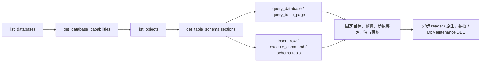

# 数据库 MCP 工作流与执行策略

当前源码契约与迁移见[工具契约](tool-evolution.md)和[5.0.0 说明](release-5.0.0.md)。agent 升级后重新读取 tools/list，并核对调用参数；Mongo 的 SRV URI 需改为显式主机 URI，更新/删除需按批量语义检查权限和筛选范围。

源码、测试和发布工具使用 .NET 10 LTS。静态目录有 54 项，包含六个基于 SqlSugar 内置 ADO 的 [MongoDB 集合工具](mongodb-collections.md)。使用 `tool list --json` 查看配置和权限允许的工具，`--all` 查看完整目录。元数据、执行计划和导出见[工具契约](tool-evolution.md)。

## 推荐工作流



1. 发现连接与能力，再读取目标表结构。不要根据 provider 名称假定所有工具都支持。
2. 每次查询、写入、schema 操作显式传 `databaseName`；CLI 对应 `--database-name`。省略时捕获当时的 currentDatabase；显式名称无效时失败，不回退。指定名称不切换或持久化全局选择。
3. 推荐 `query_database`：类型化参数、明确 outputSchema、相同内容的 text/structuredContent、实际数据库名和配置版本。默认最多 1000 行、1 MiB 工具 JSON、30 秒命令超时。
4. 单表逐页读取使用 `query_table_page`。未指定 columns/filters/orderBy 时，按非空复合主键定义顺序生成参数化 SQL，逐行施加预算，优先使用 nextCursor 续页；相同配置内容/路径、工作目录、目标库及查询条件下可跨 CLI 进程使用。指定任意新增选项时，直接调用 SqlSugar `ToOffsetDataTablePageAsync(page, pageSize)` 按页码读取，排序末尾追加缺失主键，整页读取后检查最终响应字节预算；该预算不限制读取期间内存。两种路径均无隐式 COUNT。cursor 不与新增选项或 page>1 同用；无主键、可空主键、能力不支持或非法页码拒绝执行。旧版本令牌需从第一页重新获取。复杂 SQL 使用查询工具自行表达。
5. SQL Server/MySQL/SQLite 单行自增插入可用 `insert_row`，其他写入按需要使用参数化 command 或专用 schema 工具。`insert_row` 要求普通表名和唯一整数自增列，SQLite 需要 AUTOINCREMENT，返回字符串 identity；row 只接受标量/null，不能指定自增列。没有跨调用事务状态，也不自动重试写操作。分页不提供跨页快照；并发写入可能导致重复或遗漏。

Mongo 使用 `mongo_find` / `mongo_aggregate` 读取已知集合，`mongo_insert_many` 插入文档数组，`mongo_update` / `mongo_delete` 批量修改，`mongo_truncate` 清空集合。没有集合发现或独立 count 工具；计数可在已知集合上使用只读 `$count` pipeline。写入确认和数据类型转换见[Mongo 契约](mongodb-collections.md)。

MCP 客户端也可读取 `db://connections`、`db://capabilities/{databaseName}` 和 `db://schema/{databaseName}/{tableName}`；调用 `analyze_slow_query` 或 `safe_schema_migration` 获取指导步骤。Prompt 不自动执行数据库操作，连接名支持补全，健康检查支持客户端请求的进度通知。

```powershell
DatabaseMcpServer tool get_database_capabilities --database-name 'reporting'
DatabaseMcpServer tool get_table_schema --table-name 'orders' --database-name 'reporting'
DatabaseMcpServer tool query_database --database-name 'reporting' --sql 'select * from orders where id=@id' --parameters '[{"name":"id","dbType":"Int64","value":"9007199254740993"}]' --max-rows 100
DatabaseMcpServer tool query_table_page --database-name 'reporting' --table-name 'orders' --page 1 --page-size 100
```

## 执行策略

启动时读取环境变量，配置错误拒绝启动。连接、权限和配置版本在排队前捕获；后续切库、reload、rename 不改变已经接纳的请求。保留独立 SqlSugarClient、IsAutoCloseConnection 和底层驱动池。

| 环境变量 | 默认值 | 含义 |
| --- | --- | --- |
| `DB_MCP_TOOL_PROFILE` | `full` | full/analysis 均筛选配置 provider/权限并集，MCP/CLI/Web 一致；analysis 进一步限分析工具 |
| `DB_QUERY_BOUNDED_DEFAULTS` | `true` | batch、多结果集省略预算时填充默认值；显式 false 保留旧行为；分页、过程和元数据始终有界 |
| `DB_MAX_CONCURRENT` / `DB_MAX_QUEUED` | `8` / `32` | 每连接执行/等待上限 |
| `DB_MAX_TOTAL_CONCURRENT` / `DB_MAX_TOTAL_QUEUED` | `32` / `128` | 应用协调器所有连接共享的执行/等待上限，范围 1–1024 / 0–10000 |
| `DB_QUEUE_TIMEOUT_SECONDS` | `30` | 一次准入的总排队时限，不会按两层额度重复计时 |
| `DB_QUERY_DEFAULT_ROWS` | `1000` | 默认返回行数 |
| `DB_QUERY_DEFAULT_BYTES` | `1048576` | 默认工具 JSON 字节数 |
| `DB_QUERY_DEFAULT_TIMEOUT_SECONDS` | `30` | 有界查询默认命令超时 |
| `DB_QUERY_MAX_ROWS` | `100000` | 调用方显式行数/分页上限 |
| `DB_QUERY_MAX_BYTES` | `16777216` | 调用方显式字节上限 |
| `DB_COMMAND_MAX_TIMEOUT_SECONDS` | `86400` | 调用方超时上限；低于原默认时也限制省略参数的调用 |
| `DB_ALLOW_INFINITE_TIMEOUT` | `true` | 是否允许显式传入超时 `0` |
| `DB_TOOL_ACCESS` | `schema-admin` | 服务端允许的工具能力上限 |
| `DB_METADATA_CACHE_SECONDS` | `30` | schema 缓存 TTL；`0` 关闭 |
| `DB_METADATA_CACHE_ENTRIES` | `128` | schema 缓存项数上限，每项最多 1 MiB（同时服从服务端字节上限） |

服务端行数/字节上限约束显式请求；batch/多结果集默认填充 1000 行、1 MiB，预算跨查询或结果集累计。升级后省略预算的调用可能返回更少的行，必须检查 `limitReached` / `truncated`。显式设置 `DB_QUERY_BOUNDED_DEFAULTS=false` 可保留这两个入口省略预算的旧行为；`query_database` 始终填充默认预算，最小字节预算 1024。单行/标量也用 `query_database`，首行可指定 `maxRows=1`。MySQL/SQL Server 存储过程使用异步 reader，达到预算时取消命令并返回 1013，不返回不完整输出参数；超限不会撤销已经发生的副作用。元数据、分页、过程、诊断和导出总 deadline 包含排队、执行与读取。

全局与单连接额度联合分配；已满连接的等待者不会占用全局执行名额或阻塞其他可运行连接，同一连接按入队顺序准入。SQL/Mongo 共用额度，驱动清理完成后才归还。独立 CLI 进程和独立 Host 各自计数。队满/排队超时返回 `1009`；外层请求 deadline 先到期时保持请求超时语义。查询默认预算与命令超时策略分离：同步 GO/DDL 省略 timeout 时保留驱动默认，并受 `DB_COMMAND_MAX_TIMEOUT_SECONDS` 限制。原子事务沿用独立总 deadline，每条命令受剩余时间及显式命令 timeout 约束。

行数限制到达后立即停读，不为判断后续是否存在而读第 N+1 行。`limitReached=true,truncated=null` 表示尚未确认后续行；字节不足导致丢弃完整行时为 `truncated=true`。不得把返回行数解释为总行数。

多结果集直接保留 reader 的值类型，不模拟旧 DataAdapter 转换。SQLite 的 NULL 首行不会改变后续整数/文本/二进制类型；datetime 文本按原字符串返回。重复列名生成唯一后缀。

响应预算计量工具 JSON，包含编码和转义，不包括 MCP/HTTP 外层。text 与 structuredContent 会重复携带数据。标准错误响应不受成功结果预算限制。驱动可能先物化大字段，预算不是进程峰值内存限制，也不是数据库计算量限制。

## 参数与权限

查询、命令和过程的 `parameters` 均为类型化对象数组；batch 命令使用 `{sql,parameters?}` 对象数组。旧 JSON 字符串和名称式输出参数已删除。支持 name/value/dbType/direction/size/precision/scale。NULL 必须声明 dbType；日期使用 ISO 8601，二进制用 base64；IN 数组暂不声明 dbType。大整数可用字符串配合 Int64，避免客户端 JavaScript 丢精度。

precision 只校验 Decimal **输入值**，要求同时给 scale，拒绝溢出和舍入。当前 SqlSugar 的 SugarParameter.Precision 不保存赋值，因此输出参数精度请求明确拒绝。字符串/二进制输出必须提供 size。MySQL / SQL Server 验证 Input/Output/InputOutput；ReturnValue 仅允许 SQL Server，其他 provider 不推测支持。

DateTimeOffset 目前允许 SQL Server/PostgreSQL；PostgreSQL 转 UTC 保留同一时刻，SQL Server 保留 offset。MySQL 等没有相同语义的 provider 明确拒绝此类型，使用 DateTime 时应由调用方约定时区。

连接可设置 `accessMode` 为 `read-only`、`read-write` 或 `schema-admin`，省略保持旧权限。它与 `DB_TOOL_ACCESS` 取更严格者：

| 模式 | 允许的操作 |
| --- | --- |
| read-only | 查询、结构读取、连接诊断 |
| read-write | 上述操作以及独立 INSERT/UPDATE/DELETE/MERGE 等 DML |
| schema-admin | 上述操作以及专用 schema、脚本和过程；通用 SQL 仍遵守原 `enableDangerousOperations` 开关 |

策略在共同执行路径检查，MCP、CLI、Web 都不能通过直接调用绕过。SQL 检查不是数据库授权系统，函数/触发器仍可产生副作用；部署账号应按实际职能授权。隐藏工具也不等于授权控制。

错误码：1001 连接失败、1002 执行失败、1003 危险 SQL、1004 参数错误、1005 配置错误、1009 队列繁忙、1010 能力被拒绝、1011 命令超时、1012 不支持的能力、1013 响应超限。按驱动错误码/异常类型分类；缺乏可靠分类的 provider 保持执行失败，不用英文错误文本猜测。MCP 的错误同时设置 `isError=true`。

## 元数据、能力与观测

`get_table_schema` 按连接、配置版本、表名和 section 缓存结果。SQLite、MySQL、PostgreSQL、SQL Server 和 DuckDB 使用原生异步读取，其他 SQL provider 的基础 section 由 SqlSugar 驱动提供。单次可查 1–50 张表，结果和缓存命中共享行数与字节预算。等待者取消不终止正在加载缓存的请求，加载失败或取消时不写缓存。DDL、存储过程和通用命令会使目标连接的缓存失效。外部 DDL 后可用 `refresh=true` 绕过缓存。

`get_database_capabilities` 分开返回配置产品、实际 provider、工具可用性和产品验证状态。四库的有界多结果集和分页已验证；TiDB/Vastbase 等即使复用相同驱动，也不会继承产品验收。旧 maxPoolSize/charset/enableSsl/allowUserVariables 为 advisory，enableBulkCopy 为 not-applicable，均不修改驱动连接字符串。驱动选项显示允许公开的有效值与来源；显式连接字符串优先，随后是驱动默认。未知或非法优化项隐藏值，具体规则见 [ORM 配置约定](orm-configuration.md)。

`DatabaseMcpServer.Execution` Meter 记录执行与排队数量、拒绝原因、超时和取消、请求与读取耗时、响应大小及元数据缓存命中。取消完成耗时包含资源清理。通过同名 ActivitySource 或日志里的 `TraceId` 关联请求，指标和 span 标签均不包含 SQL、参数或连接串。同步 GO/DDL 在驱动返回后才检查取消的路径仍受驱动限制。

## 验证和发布

```powershell
dotnet test 'DatabaseMcpServer.slnx' -c 'Release' --filter 'Category!=Integration&Category!=MongoIntegration'
pwsh -NoProfile -File 'scripts/test-integration.ps1'
pwsh -NoProfile -File 'scripts/test-mongodb-integration.ps1'
pwsh -NoProfile -File 'scripts/test-package.ps1'
dotnet list 'DatabaseMcpServer.slnx' package --vulnerable --include-transitive
```

包测试使用临时 prerelease 版本，将包安装到独立 tool-path 后验证 CLI 和 stdio。

官方依据：[MCP SDK tools](https://github.com/modelcontextprotocol/csharp-sdk/blob/v2.4.0/docs/concepts/tools/tools.md)、[SqlSugar ADO](https://www.donet5.com/Home/Doc?typeId=1198)、[SQL 分页](https://www.donet5.com/Home/Doc?typeId=1197)、[库表管理缓存](https://www.donet5.com/Home/Doc?typeId=1203)、[AOP](https://www.donet5.com/Home/Doc?typeId=1204)。
