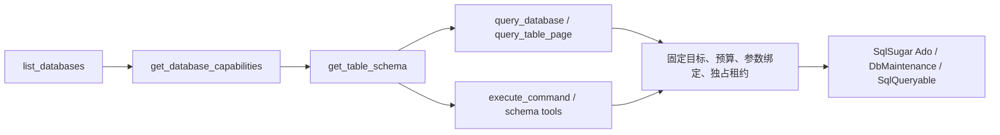

# 数据库 MCP 工作流与执行策略

当前工具契约见[兼容清理记录](compatibility-cleanup.md)。agent 升级后重新读取 tools/list；配置文件无需迁移。

本轮基于 MCP SDK 2.4.0、SqlSugarCore 5.1.4.221，源码目标框架为 .NET 9 / .NET 10，发布工具仅 .NET 10。工具目录为 62 项，包含六个 [MongoDB 集合工具](mongodb-collections.md)，运行 `DatabaseMcpServer tool list` 查看当前安装包的目录。

## 推荐工作流



1. 发现连接与能力，再读取目标表结构。不要根据 provider 名称假定所有工具都支持。
2. 每次查询、写入、schema 操作显式传 `databaseName`；CLI 对应 `--database-name`。省略时捕获当时的 currentDatabase；显式名称无效时失败，不回退。指定名称不切换或持久化全局选择。
3. 推荐 `query_database`：类型化参数、明确 outputSchema、相同内容的 text/structuredContent、实际数据库名和配置版本。默认最多 1000 行、1 MiB 工具 JSON、30 秒命令超时。
4. 单表逐页读取使用 `query_table_page`。SqlSugar `SqlQueryable<object>` + 外置 `OrderBy` + `ToDataTablePageAsync`，按全部主键列升序，无隐式 COUNT。无主键表、未实现分页的 provider、非法页码拒绝执行；兼容驱动可用性与产品验证程度分别诊断。复杂 SQL 使用查询工具自行表达。
5. 写入按需要使用参数化 command 或专用 schema 工具。没有跨调用事务状态，也不自动重试写操作。分页受数据库当前隔离级别影响，不提供跨页快照；并发写入可能导致重复或遗漏。

```powershell
DatabaseMcpServer tool get_database_capabilities --database-name 'reporting'
DatabaseMcpServer tool get_table_schema --table-name 'orders' --database-name 'reporting'
DatabaseMcpServer tool query_database --database-name 'reporting' --sql 'select * from orders where id=@id' --parameters '[{"name":"id","dbType":"Int64","value":"9007199254740993"}]' --max-rows 100
DatabaseMcpServer tool query_table_page --database-name 'reporting' --table-name 'orders' --page 1 --page-size 100
```

## 执行策略

启动时读取环境变量，配置错误拒绝启动。连接、权限和配置版本在排队前捕获；后续切库、reload、rename 不改变已经接纳的请求。保留独立 SqlSugarClient、IsAutoCloseConnection 和底层驱动池。

| 环境变量 | 默认值 | 含义 |
| --- | --- | --- |
| `DB_QUERY_BOUNDED_DEFAULTS` | `false` | 保留配置语义：控制 batch、多结果集、single/scalar 和过程的省略预算默认值 |
| `DB_QUERY_DEFAULT_ROWS` | `1000` | 默认返回行数 |
| `DB_QUERY_DEFAULT_BYTES` | `1048576` | 默认工具 JSON 字节数 |
| `DB_QUERY_DEFAULT_TIMEOUT_SECONDS` | `30` | 有界查询默认命令超时 |
| `DB_QUERY_MAX_ROWS` | `100000` | 调用方显式行数/分页上限 |
| `DB_QUERY_MAX_BYTES` | `16777216` | 调用方显式字节上限 |
| `DB_COMMAND_MAX_TIMEOUT_SECONDS` | `86400` | 调用方超时上限；低于原默认时也限制省略参数的调用 |
| `DB_ALLOW_INFINITE_TIMEOUT` | `true` | 是否允许显式传入超时 `0` |
| `DB_TOOL_ACCESS` | `schema-admin` | 服务端允许的工具能力上限 |
| `DB_METADATA_CACHE_SECONDS` | `30` | schema 缓存 TTL；`0` 关闭 |
| `DB_METADATA_CACHE_ENTRIES` | `128` | schema 缓存项数上限，每项最多 1 MiB（同时服从服务端字节上限） |

服务端行数/字节上限约束显式请求；未开启默认预算时，batch/多结果集允许省略行数和字节预算，但仍走同一 reader 执行路径。若要填充这些工具的默认预算，应启用 `DB_QUERY_BOUNDED_DEFAULTS=true`。`query_database` 始终填充默认预算，最小字节预算 1024。`sql_query_single` / `get_scalar` 支持 `maxResponseBytes`；超限返回 1013，不截断单值。存储过程也支持响应字节限制，但仍先通过同步 DataTable 读取；超限错误不会撤销已经发生的过程副作用。

行数限制到达后立即停读，不为判断后续是否存在而读第 N+1 行。`limitReached=true,truncated=null` 表示尚未确认后续行；字节不足导致丢弃完整行时为 `truncated=true`。不得把返回行数解释为总行数。

多结果集直接保留 reader 的值类型，不模拟旧 DataAdapter 转换。SQLite 的 NULL 首行不会改变后续整数/文本/二进制类型；datetime 文本按原字符串返回。重复列名生成唯一后缀。

响应预算计量工具 JSON，包含编码和转义，不包括 MCP/HTTP 外层。text 与 structuredContent 会重复携带数据。标准错误响应不受成功结果预算限制。驱动可能先物化大字段，预算不是进程峰值内存限制，也不是数据库计算量限制。

## 参数与权限

查询、命令和过程的 `parameters` 均为类型化对象数组；batch 命令使用 `{sql,parameters?}` 对象数组。旧 JSON 字符串和名称式输出参数已删除。支持 name/value/dbType/direction/size/precision/scale。NULL 必须声明 dbType；日期使用 ISO 8601，二进制用 base64；IN 数组暂不声明 dbType。大整数可用字符串配合 Int64，避免客户端 JavaScript 丢精度。

precision 只校验 Decimal **输入值**，要求同时给 scale，拒绝溢出和舍入。当前 SqlSugar 的 SugarParameter.Precision 不保存赋值，因此输出参数精度请求明确拒绝。字符串/二进制输出必须提供 size。MySQL / SQL Server 验证 Input/Output/InputOutput；ReturnValue 仅允许 SQL Server，其他 provider 不推测支持。

DateTimeOffset 目前允许 SQL Server/PostgreSQL；PostgreSQL 转 UTC 保留同一时刻，SQL Server 保留 offset。MySQL 等没有相同语义的 provider 明确拒绝此类型，使用 DateTime 时应由调用方约定时区。

连接可设置 `accessMode` 为 `read-only`、`read-write` 或 `schema-admin`，省略保持旧权限。它与 `DB_TOOL_ACCESS` 取更严格者：

| 模式 | 允许的操作 |
| --- | --- |
| read-only | 查询、结构读取、连接诊断 |
| read-write | 上述操作以及独立 INSERT/UPDATE/DELETE/MERGE 等 DML |
| schema-admin | 上述操作以及专用 schema、脚本和过程；通用 SQL 仍遵守原 `enableDangerousOperations` 开关 |

策略在共同执行路径检查，MCP、CLI、Web 都不能通过直接调用绕过。SQL 检查不是数据库授权系统，函数/触发器仍可产生副作用；部署账号应按实际职能授权。隐藏工具也不等于授权控制。

错误码：1001 连接失败、1002 执行失败、1003 危险 SQL、1004 参数错误、1005 配置错误、1009 队列繁忙、1010 能力被拒绝、1011 命令超时、1012 不支持的能力、1013 响应超限。按驱动错误码/异常类型分类；缺乏可靠分类的 provider 保持执行失败，不用英文错误文本猜测。MCP 的错误同时设置 `isError=true`。

## 元数据、诊断与观测

`get_table_schema` 复用一次 `GetColumnInfosByTableName(table,false)` 的列结果生成主键和自增列，避免重复查列；应用缓存包含连接稳定身份、配置版本、表名（可含 schema），合并同项并发加载。DDL、过程和通用命令完成后保守失效目标连接；部分失败/取消也失效。`refresh=true` 绕过缓存；外部 DDL 用 refresh 或等待 TTL。重命名后完成的旧写入仍能失效新名称下的缓存。

`get_database_capabilities` 分开返回配置产品、实际 provider、工具可用性和产品验证状态。四库的有界多结果集和分页已验证；TiDB/Vastbase 等即使复用相同驱动，也不会继承产品验收。旧 maxPoolSize/charset/enableSsl/allowUserVariables 为 advisory，enableBulkCopy 为 not-applicable，均不修改驱动连接字符串。驱动选项显示允许公开的有效值与来源；显式连接字符串优先，随后是驱动默认。未知或非法优化项隐藏值，具体规则见 [ORM 配置约定](orm-configuration.md)。

`DatabaseMcpServer.Execution` Meter 包含 active/queued/rejected/cancelled、queue/sql/read/request/serialize duration 和 response bytes，无 SQL、参数值、连接串标签。SqlSugar AOP 的 SqlExecutionTime 与完整读取耗时分开；读取指标包含映射和有界行编码。同步过程/GO 不承诺执行中立即取消。

## 验证和发布

```powershell
dotnet test 'DatabaseMcpServer.slnx' -c 'Release' --filter 'Category!=Integration'
pwsh -NoProfile -File 'scripts/test-integration.ps1'
pwsh -NoProfile -File 'scripts/test-package.ps1'
dotnet list 'DatabaseMcpServer.slnx' package --vulnerable --include-transitive
```

包测试使用临时 prerelease 版本，本地 pack → tool-path 安装 → CLI/stdio，不发布、不全局安装；CI net10 job 已加入该流程。正式版本 3.7.0 未改动。共享 CreateClient API 和接口默认兜底已删除。MCP resources、MongoDB 实库扩展仍不在本轮范围。

官方依据：[MCP SDK tools](https://github.com/modelcontextprotocol/csharp-sdk/blob/v2.4.0/docs/concepts/tools/tools.md)、[SqlSugar ADO](https://www.donet5.com/Home/Doc?typeId=1198)、[SQL 分页](https://www.donet5.com/Home/Doc?typeId=1197)、[库表管理缓存](https://www.donet5.com/Home/Doc?typeId=1203)、[AOP](https://www.donet5.com/Home/Doc?typeId=1204)。

## 前一轮验收证据（清理前基线）

Windows 本机 net9/net10 **各 349 项常规测试通过**；Docker MySQL 8.4/PostgreSQL 17/SQL Server 2022 **各 TFM 38 项集成测试通过**。构建 0 warning/error；NuGet 含传递依赖审计未报告已知漏洞。没有使用子代理，没有提交、暂存或发布本轮改动。

| Requirement | Evidence |
| --- | --- |
| 命名读写/schema 不改变全局选择，队列捕获版本和权限 | `NamedRequests_ReadWriteAndSchemaStayOnTargetWithoutChangingSelection`、`NamedQueuedRequest_KeepsVersionAndPolicyAcrossRenameAndReload`、`ExplicitInvalidTarget_DoesNotFallBack` |
| 服务端预算、单值超限、实际 UTF-8 | `Budgets_ApplyDefaultsCapsAndSingleValueLimit`、`StructuredQuery_CliBindingTypedNullAndBoundedUnicode` |
| 共同权限层，read-write 不能绕过 DDL 限制 | `ReadOnlyPolicy_BlocksAllMutationPathsButAllowsQueries`（含 CLI/Web）、`ReadWritePolicy_RejectsDdlEvenWhenDangerousOperationsEnabled`、`Tools_PublishCurrentSchemasAndQueryPayloadsOverProtocol`（含 MCP） |
| 类型化参数精度、NULL、类型和时区 | `Binder_PreservesExactClrTypeAndValue`、`Binder_RejectsRoundingOverflowAndAmbiguousDates`、`Binder_ValidatesNullOutputSizePrecisionAndProviderCapabilities`；三库 `TypedQueryAndCommand_PreserveNullNumericDateAndArrayValues`、`TypedOffset_PreservesInstantAcrossProviderTimezoneRules` |
| 真实输出/InputOutput、有界多结果集、取消结束 | `TypedProcedure_PreservesOutputAndInputOutputTypes`、`BoundedMultiple_MatchesNativeDataSetMappingsAndStopsAtBudget`、`StructuredQueryCancellation_StopsServerActivityAndReleasesLease` |
| schema 缓存隔离/刷新/失效/TTL/容量/并发合并 | `SchemaCache_IsolatesTargetsRefreshesAndInvalidatesAfterDdl`、`MetadataCache_CoalescesLoadsExpiresBoundsCapacityAndDoesNotResurrectInvalidation` |
| 分页与配置真实性 | `TablePagination_UsesUniqueOrderRejectsMissingKeyAndAvoidsImplicitCount`、`CapabilityDiagnostics_ReportActualDriverOptionsAndRedactSecrets` |
| 错误分类、观测指标 | `Errors_ClassifyUnsupportedInvalidJsonAndProviderCodesWithoutMessageMatching`、`Telemetry_RecordsBalancedLeasesReadingAndPayloadBytesWithoutSqlTags` |
| 安装包与旧入口兼容 | `scripts/test-package.ps1`：临时安装成功、stdio 59 tools、CLI 失败退出码 1；`scripts/verify-cli-tools.ps1`：目录覆盖 59/59，SQLite 45 成功/14 不支持操作，三个新增工具均成功 |

故障注入：临时移除显式数值转换的 round-trip 校验，Single 精度丢失、Double 大整数舍入、Decimal 极小数归零三个用例均失败；恢复后 20 项类型化参数用例通过，随后全量常规测试通过。完整 stdio 测量为 213 字节工具 JSON / 667 字节响应行，含两份数据和封装。并发测量见[执行优化记录](execution-optimization.md)。远端 CI 已配置，未把本地运行描述为远端 CI 已通过。
