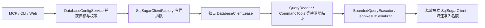

# MCP 执行优化与验证记录

日期：2026-11-20。基于计划 `plans/2026-11-19-mcp-execution-optimization.md` 实施。本文记录执行层优化基线；后续已升级 ModelContextProtocol 2.4.0、SqlSugarCore 5.1.4.221，当前工具接口已收敛，见[兼容清理记录](compatibility-cleanup.md)，详见 [依赖升级与验证](dependency-upgrade.md)。

## 生命周期



限额按进程内配置连接计算，默认 8/32/30 秒是可配置的保守初值，不是生产容量结论。1、8、32 个执行名额及 32 个等待者的确定性测试验证上限、队满拒绝和排空；真实吞吐需按数据库连接池、SQL 和服务端能力调参。

2026-11-20 进一步对齐官方上下文生命周期：移除空闲 SqlSugarClient 缓存，依靠驱动连接池复用物理连接。详见 [真实驱动回归](provider-integration.md)。

旧版本请求持有快照，重载不会换掉其目标；正常重命名迁移并发身份。如果重命名目标曾被删除但仍有活动请求，保存可能成功、运行时应用暂缓；等待旧请求结束后 reload，继续沿用源连接的并发身份。

## Provider 能力矩阵

新增类型化查询、按主键分页、缓存与权限详见[数据库 MCP 工作流](database-mcp-workflow.md)。

| 路径 | 执行入口 | 读取 / NextResult | 取消与验证范围 |
| --- | --- | --- | --- |
| 普通、IN、single、scalar 查询 | SqlSugar `GetDataReaderAsync` / `GetScalarAsync` 下传 `Ado.CancellationToken` | `DbDataReader.ReadAsync(token)`；普通 IDataReader 回退为同步并在前后检查 | SQLite 结果、预算和参数回归通过；SQLite async 不保证抢占正在执行的同步 native 调用 |
| 多结果集（统一 reader） | `GetDataReaderAsync` | `ReadAsync` / `NextResultAsync` | SQLite、MySQL、PostgreSQL、SQL Server 映射验证；其他 provider 明确返回不支持能力 |
| 普通/批量写命令 | `ExecuteCommandAsync` 下传令牌 | 无 reader | SQLite 已完成写入保留、后续 batch 停止；没有新增自动回滚/重试 |
| 存储过程、输出参数、GO、schema、健康检查 | 保留同步 SqlSugar 入口 | 同步 | 受并发额度限制；这些路径尚未验证执行中取消，不替换 provider 映射/输出参数行为 |
| 连接重试 | 排队与退避可取消，CheckConnection 同步 | 不适用 | 同一次重试固定目标；繁忙准入错误不作为连接失败重试 |
| MySQL / PostgreSQL / SQL Server | 共用上面的令牌转发代码 | 取决于实际 reader | 已增加隔离 Docker 集成验证，范围与复现方式见下；其他 provider 不据此推定支持 |

实现核对以已安装 DLL 为准：SqlSugar AdoProvider reader/scalar/nonquery 异步路径将令牌传给驱动，但连接打开/映射仍可能同步。没有绕过 SqlSugar 的参数绑定、AOP 或事务，也没有将 WaitAsync/Task.Run 作为驱动停止的证明。可控 DbDataReader 测试验证取消后等待驱动退出再关闭 reader、释放额度。

## 2026-11-20 结构化查询测量

新入口 `query_database`，Windows/net10 Release/SQLite 文件库（Pooling=False），每进程预热 5 次，再执行 64 次查询，每次 1000 行两列，含中文字符串。服务端最多 8 个租约、队列 64；线程池最小工作线程 64。每个并发级别独立进程，计时覆盖租约、SQL、映射、类型化对象、JSON 和 structuredContent，排除 MCP transport；分配为整个采样期 GC 总分配差值除请求数；峰值工作集包含预热/取消探针。

| 请求并发 | P50 ms | P95 ms | 每请求分配 bytes | 进程峰值工作集 bytes | 实测峰值租约 | 排队取消结束 ms |
| --- | --- | --- | --- | --- | --- | --- |
| 1 | 9.31 | 11.76 | 1,429,631 | 67,133,440 | 1 | 4.48 |
| 8 | 22.45 | 59.24 | 1,459,584 | 84,942,848 | 8 | 2.97 |
| 32 | 48.74 | 129.52 | 1,471,054 | 90,390,528 | 8 | 0.87 |

这是当前实现的容量观察，没有与旧入口的等价对照，不推导“提升百分比”。SQLite 连接最多不超过活动租约数（本次关闭驱动池），不是三库服务端会话数测量。三库执行中取消另由集成测试查询服务器活动视图验证。高并发下尾延迟增加，部署应按数据库容量选择并发上限，不能只增加线程数。

安装包 stdio 实测：单行 typed Int64 查询工具 JSON 为 213 UTF-8 bytes，包含 text、structuredContent 和 JSON-RPC 封装的实际响应行为 667 bytes。因此 maxResponseBytes 不作为完整协议消息的上限。脚本为 `scripts/test-package.py`。

真实 MCP SDK 管道测试覆盖 tools/list、tools/call、参数 schema、只读注解、正常/SQL 安全错误结果以及显式 `notifications/cancelled` 到服务端令牌的传递。当前 SDK 的客户端本地 token 取消在本机复测中未可靠触发服务端结束；显式发送取消通知通过。自动通知的根因未确认，不在服务器中注入绕过协议的修补，也未改变协议版本。

## 性能测量

Windows 本机 net9 Release，SQLite 内存库，递归查询 10,000 行，两列（序号 + 36 字符字符串），maxRows=10000、maxResponseBytes=2000000；预热 3 次、采样 5 次。每次使用 GC.GetTotalAllocatedBytes(true) 差值与 Stopwatch；范围为 SQL、映射及有限结果编码，排除最终 MCP/HTTP 封装。

| 指标 | 修改前 | 修改后 |
| --- | --- | --- |
| 返回字节（每次） | 598,973 | 598,973 |
| 分配字节（5 次） | 16,624,904 / 14,543,048 / 16,630,024 / 14,542,960 / 16,629,576 | 6,224,800 / 6,224,888 / 6,224,296 / 6,224,800 / 6,224,800 |
| 耗时 ms（5 次） | 59.59 / 62.00 / 59.98 / 64.17 / 66.03 | 53.79 / 58.69 / 50.08 / 55.19 / 75.34 |
| 分配中位数 | 16,624,904 | 6,224,800（下降约 62.6%） |
| 耗时中位数 | 62.00 ms | 55.19 ms |

主要收益来自每结果集复用 writer/stream、去除逐字段 Flush。仍保留每行 byte[] 和最终合并，未增加 ArrayPool 或通用缓冲抽象。预算约束响应，不约束驱动已物化的字段或数据库计算量。

补充对照使用相同 SQL/数据，各场景独立进程、3 次预热 + 5 轮采样；旧版本从基线提交读取到 Git 元数据中的临时基准项目，未修改工作树。SQL 场景读取两列但不编码；行编码使用预建 DataTableReader 与字典映射（含读取/映射、不含最终 JSON 合并）；有限查询包含 SQL、编码、结果合并与 JSON 校验，不含 MCP/HTTP、池准入。并发场景由测试程序调度独立 SQLite 客户端，P50 为整轮耗时，P95 为开始执行后的单请求耗时，均不作为生产延迟保证。

| 场景 | 旧→新 P50 ms | 旧→新 P95 ms | 旧→新分配 B/请求 | 旧→新 请求/秒 | 旧→新进程峰值 MiB |
| --- | --- | --- | --- | --- | --- |
| SQL 读取，1 路 | 10.34 → 9.75 | 12.17 → 10.97 | 961,728 → 962,088 | 96.67 → 102.54 | 48.36 → 49.73 |
| 行编码，1 路 | 56.95 → 32.24 | 66.77 → 33.12 | 12,664,568 → 4,345,200 | 17.56 → 31.02 | 53.68 → 54.19 |
| 有限查询，1 路 | 86.80 → 56.04 | 103.06 → 74.96 | 14,544,816 → 6,225,648 | 11.52 → 17.85 | 60.18 → 70.93 |
| 有限查询，8 路 | 177.59 → 179.96 | 155.17 → 139.77 | 14,547,277 → 6,228,935 | 45.05 → 44.45 | 81.04 → 76.97 |
| 有限查询，32 路 | 519.25 → 543.35 | 96.29 → 123.55 | 14,546,154 → 6,226,060 | 61.63 → 58.89 | 86.71 → 95.89 |

行编码每请求均产生 588,894 字节行数据，有限查询每请求均返回 598,973 字节。8 路吞吐近似持平，32 路略降；较低的累计分配不等于较低进程峰值，不能推算所有负载更快。保留默认 8 个名额，真实数据库容量与取消延迟仍需隔离实例验证。基准源码和原始 JSONL 保留在本机 `.git/testagent/mcp-execution/perf/`（不参与提交）。

Web ToolPlayground 用 defineAsyncComponent 延迟加载，保留 visited/v-show 页面状态。构建确认单独 JS 为 19.48 kB（gzip 6.30 kB），主 JS 706.69 kB（gzip 214.60 kB），仍有主块 >500 kB 的 Vite 提示。遵循 Modern Web Guidance performance 的 “DON'T load invisible or unreachable CSS/JS”。

## 交付范围与后续边界

### 2026-11-20 后续：消除最终输出的重复复制

`JsonResultSerializer.Serialize` 对顶层 `BoundedJsonResult` 直接解码 UTF-8。有限查询已生成完整且受预算约束的 JSON，不再经过额外 JsonSerializer/Utf8JsonWriter 中转；普通对象仍采用原缩进/camelCase，嵌套预编码结果继续使用 converter。工具名称、结构、中文/转义、数字文本、null 和字节预算不变。

本机 net9 Release，固定 10,000 行/598,973 字节的同一预编码结果；只测最终输出到字符串，不包含 SQL、编码或传输。旧/新路径交替测量，3 轮预热 + 9 轮采样，每轮每路径 100 次，轮前执行 GC；先比较两个路径输出完全相等。原始结果保留于 `.git/testagent/serialization-20261120/results.jsonl`。

| 中位数 | 旧路径 | 直接解码 |
| --- | --- | --- |
| 单次输出耗时 | 0.466 ms | 0.386 ms |
| 单次托管分配 | 1,210,699 B | 1,198,104 B |

输出阶段耗时约下降 17%，分配约下降 1%；现有 writer 已复用缓冲，因此没有大幅减少分配，不代表整次查询快 17%。此改动未引入额外缓存、ArrayPool 或新公共接口。

回归测试：`Serialize_PreencodedResultPreservesJsonAndUtf8ByteBudget`、`Serialize_OrdinaryResultsKeepIndentedCamelCaseAndStringEscaping`、`Serialize_NestedPreencodedResultsRemainJsonObjects`。普通输出测试明确保留平台默认换行。本轮全量 net9/net10 各 268 passed、0 failed、0 skipped；未改前端。命令：`dotnet test 'tests/DatabaseMcpServer.Tests/DatabaseMcpServer.Tests.csproj' -c 'Release' --no-restore`。

配置更新/重命名共用 DatabaseConfigurationApplicationService，诊断共用 DatabaseConnectionDiagnostics；移除了重复重命名 helper、诊断嵌套 Host 和全局 Console 重定向。其他配置 CRUD 继续复用现有 CLI handler，没有扩展成通用命令框架。Web 查询放开全局串行门；写入/管理工具继续串行。

`.github/workflows/verify.yml` 独立验证 net9/net10、前端和 Docker provider 集成，不发布；NuGet 安全告警在 CI 中作为错误处理。2026-11-20 已将 MySqlConnector 固定为 2.6.2、System.Security.Cryptography.Pkcs 固定为 8.0.2，修复原 2.2.5 / 8.0.1 的已知漏洞；后续 SqlSugar 升级记录见 [依赖升级与验证](dependency-upgrade.md)。

数据库行为验证使用隔离 SQLite、可控替身和本轮 Docker 临时数据库，未操作真实业务数据库。配置跨文件原子事务、存储过程/GO 全异步和生产容量评估不在已完成声明内。

## 验证证据

初轮基线 net9.0 / net10.0 各 **265 passed，0 failed，0 skipped**；前端 **16 passed / 8 files**；Release solution build 0 errors。序列化优化后基线为各 268 passed。本轮真实驱动验证另见下文；原 NuGet 漏洞告警已修复，Vite 大块提示仍属于前端后续工作。

| Requirement | Evidence |
| --- | --- |
| MCP 工具名、参数、注解、正常/错误和取消协议 | `McpProtocolTests.Tools_PublishCurrentSchemasAndQueryPayloadsOverProtocol`（当前工具契约） |
| 注入参数隐藏，Web 取消透传，CLI 130 | `QueryCancellationTests.PreCancelledQuery_DoesNotExecuteAndTokenIsNotAnOption` |
| reader/NextResult 结束前不归还租约 | `QueryCancellationTests.ReaderCancellation_HoldsLeaseUntilDriverExits`（两种读取） |
| batch 取消停止后续 SQL，已完成写入保留 | `CancellationDuringBatch_StopsFollowingSqlAndDiscardsLease`、`BatchCancellation_PreservesCompletedWriteAndStopsFollowingCommands` |
| 普通 SQL 失败逐项返回且继续，超时/令牌恢复 | `BatchSqlFailure_KeepsPerCommandResultsAndContinues`、`CommandScope_RestoresTimeoutAndCancellationOnFailure` |
| 队满/超时/取消回收，1/8/32 档并发上限 | `Queue_CancelsRejectsOverflowAndReturnsCapacity`、`QueueTimeout_DoesNotConsumeActiveCapacity`、`ConfiguredConcurrency_AdmitsExactlyLimitAndDrainsQueue` |
| 切库/改权限/重载/重命名保留快照与额度 | `WaitingRequest_KeepsTargetAndPermissionsAcrossSwitchAndReload`、`ReloadAndRename_KeepOldTargetAndShareAdmission`、`RenameIntoRetiredName_RetryPreservesSourceAdmission` |
| shutdown、初始化失败、弃用预留与深复制 | `Shutdown_CancelsWaitingButKeepsActiveLeaseUntilReturn`、`FailedCreationAndAbandonedReservation_DoNotLeakCapacity`、`DifferentDatabases_DoNotShareLimitsAndSnapshotsAreDefensive` |
| UTF-8 完整行、无 N+1、跨结果集预算/映射 | `BoundedQuery_EnforcesUtf8BudgetAndReturnsWholeRows`、`BoundedQuery_StopsBeforePoisonedNextRow`、`BoundedMultiple_PreservesReaderValuesAndDuplicateColumnOrdinals` 及现有 QueryToolsTests |
| 合并编辑校验、部分成功身份、真实运行状态 | `CombinedEdit_ValidatesBeforeRenameAndPublishesTogether`、`PartialEdit_ReportsSavedIdentityAndCanBeRetried`、`Dashboard_ReportsActiveSelectionAndUnappliedChanges`、`Dashboard_KeepsActiveTargetWhenSavedFileIsUnavailable` |
| 诊断不重定向 Console，测试保存的候选 | `Diagnostics_KeepProcessWritersAndUseSavedCandidate` |
| 前端部分成功重试、旧保存不覆盖新编辑 | `retries using the persisted identity when saved=%s`、`keeps a new editor when an earlier save finishes with success=%s` |
| 分块、性能、独立 CI | 实际 dist ToolPlayground 块、本页基准对照、`.github/workflows/verify.yml`（本地验证完成，远端 workflow 未执行） |

在仓库根目录复现：

```powershell
dotnet test 'tests/DatabaseMcpServer.Tests/DatabaseMcpServer.Tests.csproj' -c 'Release'
dotnet build 'DatabaseMcpServer.slnx' -c 'Release'
npm --prefix 'website' test
npm --prefix 'website' run build
git diff --check
```
