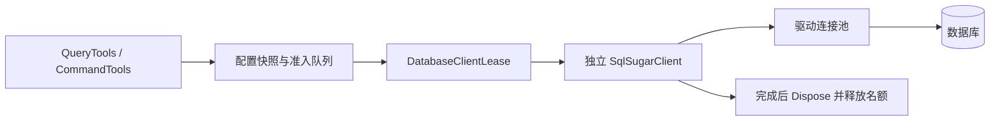

# SqlSugar 官方用法对齐与容器回归

## 本轮改变

`SqlSugarClientFactory` 每个租约新建、独占并释放 `SqlSugarClient`，保留 `IsAutoCloseConnection=true`，物理连接由底层驱动池化。取消或异常后的 ADO/AOP 状态不会进入下一次请求。已删除共享 `CreateClient` / `SqlSugarScope` 入口；配置快照、准入队列、重命名身份语义保留。



JSON 数字转换原先的 `long : double` 条件表达式会先提升为 double，再装箱；这会丢失大整数精度，也会使 PostgreSQL 的 bigint 函数匹配失败。现在分别转换为 Int64、精确 decimal 或可往返 double，IN 参数复用同一个转换入口。测试使用 9007199254740993、12345678901234.5678 和 1e-50 验证真实往返；不可往返的精度/范围返回参数错误。

依赖固定为 MySqlConnector 2.6.2 和 System.Security.Cryptography.Pkcs 8.0.2，已修复 GHSA-473q-m89c-ghf8、GHSA-2fmv-rv2c-59x7、GHSA-846f-f764-76mx。SqlSugarCore 后续升级到 5.1.4.221，完整版本矩阵与最新回归结果见 [依赖升级与验证](dependency-upgrade.md)。

## 复现

在仓库根目录，安装 PowerShell 7、Docker Linux containers、.NET 9/10 SDK 和 Node.js。三个容器合计内存上限 4.5 GiB，宿主还需预留测试进程内存。

```powershell
pwsh -NoProfile -File 'scripts/test-integration.ps1'
# 仅运行一个目标框架
pwsh -NoProfile -File 'scripts/test-integration.ps1' -Framework 'net10.0'
```

脚本创建 MySQL 8.4、PostgreSQL 17、SQL Server 2022 Developer 容器。容器名称与 label 使用随机运行标识，端口仅绑定 127.0.0.1，由 Docker 分配；口令随机生成，通过进程环境传递。数据库为容器内 `dbmcp_test`。脚本有健康检查截止时间，无论测试成功或失败都会清理本次容器及其匿名卷、恢复环境变量。硬杀进程/宿主崩溃时 finally 无法保证执行；可按本次控制台中的容器名及 `dbmcp.integration` label 定位残留，不要全局清理 Docker。

镜像采用版本标签，补丁可能随上游更新；脚本输出实际镜像 digest，便于冻结发布验证。报告写入忽略的 `TestResults/integration/<TFM>/*.trx`；脚本还检查 TRX，拒绝零测试或全部跳过的假成功。CI 只上传 TRX，不上传内存转储或连接配置。

普通 `dotnet test` 默认跳过这组集成测试。脚本设置 `DBMCP_RUN_INTEGRATION=1` 及 `DBMCP_TEST_MYSQL` / `DBMCP_TEST_POSTGRESQL` / `DBMCP_TEST_SQLSERVER`；显式启用但缺连接串会失败。手动指定连接串时只能指向专用测试库，测试需要建表/存储过程权限及服务端活动查询权限，不能指向业务库。

## 验证范围

| 行为 | 具体测试 |
| --- | --- |
| 参数绑定、Unicode、NULL、datetime、decimal、大整数、IN、有限/普通读取 | `ParametersAndTypedRows_RoundTripThroughTools`（三个 provider） |
| 极小 double 不因 decimal 转换归零 | `TinyNumbers_RoundTripWithoutBecomingZero`（三个 provider，普通/有界读取） |
| 多结果集顺序、空结果集、数值类型 | `MultipleResults_PreserveEmptySetsTypesAndOrder`（三个 provider） |
| 查询及命令执行中取消，服务端工作停止，单个准入名额恢复 | `InFlightCancellation_StopsServerWorkAndReleasesSlot`（六种组合） |
| 锁等待中的命令超时，未发生迟到写入，后续请求正常 | `CommandTimeout_ReturnsFailureAndConnectionRemainsUsable`（三个 provider） |
| 批量取消保留已完成写入、不执行后续写入 | `BatchCancellation_KeepsCompletedWriteAndSkipsFollowingWrite`（三个 provider） |
| 存储过程返回行及输出参数，后续普通 SQL 正常 | `StoredProcedure_ReturnsRowsAndOutputThenAllowsTextQuery`（MySQL / SQL Server） |
| PostgreSQL bigint 函数绑定 | `PostgreSqlFunction_IsInvokedWithParameterizedSelect` |
| SQL Server GO 分批顺序与影响行数 | `SqlServerGo_ExecutesAllBatchesInOrder` |
| ADO/AOP 状态隔离与异常释放 | `ReturnedContext_DoesNotLeakAdoOrAopState`、`FailedTool_DisposesContextAndReleasesCapacity` |
| JSON 整数/小数与数组精度 | `ParseParameters_PreservesIntegerTypeAndPrecisionAboveDoubleRange`、`ParseParameters_PreservesDecimalAndArrayValuesWithoutRounding` |

取消测试用独立 SqlSugar 上下文查询 processlist / pg_stat_activity / sys.dm_exec_requests，确认慢 SQL 已在服务端执行后才取消；不以 Task 取消作为数据库停止的唯一证据。超时测试由另一连接持有行锁，确认超时后未写入，避免 MySQL SLEEP 中断后仍可成功返回的特殊语义。

边界：JSON null 不携带 SQL 类型，PostgreSQL 插入 integer 空值使用显式 `CAST(@optional AS integer)`；不会猜测列类型。现有存储过程输出接口只提供参数名，遵循 `new SugarParameter(name, null, true)` 默认类型，整数输出可能是字符串，保持 provider 原值。PostgreSQL 函数使用参数化 SELECT，本轮不宣称其过程/游标接口全面验证。

完整多结果集、存储过程和 GO 保持 SqlSugar 同步入口，不承诺这些同步路径可在执行中取消。2026-11-20 后续职能优化已扩展三库有界多结果集，见下文。没有生产性能基准，不宣称吞吐提升百分比。

## 2026-11-20 升级前基线验证

- Windows + Docker Desktop Linux containers；镜像 MySQL 8.4.10、PostgreSQL 17.11、SQL Server 2022。
- `dotnet test 'DatabaseMcpServer.slnx' -c 'Release' --no-restore`：net9/net10 各 271 passed、0 failed、8 skipped（8 个需显式启用的集成 Theory）。
- `pwsh -NoProfile -File 'scripts/test-integration.ps1'`：net9/net10 各 22 passed、0 failed、0 skipped；分别展开到三个 provider，最终清理本轮全部容器及匿名卷。
- `dotnet list 'DatabaseMcpServer.slnx' package --vulnerable --include-transitive --format 'json'`：生产/测试项目均未报告已知漏洞。
- `dotnet restore 'DatabaseMcpServer.slnx' '-warnaserror:NU1901,NU1902,NU1903,NU1904'`：退出码 0。
- `dotnet build 'DatabaseMcpServer.slnx' -c 'Release' --no-restore`：0 warnings、0 errors；`git diff --check` 通过。
- 故障注入：临时恢复原 `long : double` 转换，两个 JsonParameterTests 均失败；恢复修复后全量通过。

本轮镜像 digest：

```text
mysql@sha256:d36d39a64cd12a5c1cc9e6aa2bfb5f8d4c81a2f6586e0a04a9ae13939db02209
postgres@sha256:18cfe3ef5e6815560c98237d6216d1e5119702fb0f3894c8785dd58b8bbe5d73
mcr.microsoft.com/mssql/server@sha256:4525e3efac9f3e241cb003bb2ff2a82818b502f37e12049d788b1a9fa7e13b7f
```

CI 已添加 Linux provider job；这里记录的是本机执行证据，尚未宣称远端 CI 已运行。

## 官方依据

2026-11-20 职能优化追加验证：net9/net10 各 **38 passed、0 failed、0 skipped**。增加 `TypedQueryAndCommand_PreserveNullNumericDateAndArrayValues`（三库）、`BoundedMultiple_MatchesNativeDataSetMappingsAndStopsAtBudget`（三库）、`TypedProcedure_PreservesOutputAndInputOutputTypes`（MySQL/SQL Server）、`TypedOffset_PreservesInstantAcrossProviderTimezoneRules`（PostgreSQL/SQL Server）、`StructuredQueryCancellation_StopsServerActivityAndReleasesLease`（三库）。超时用例新增 1011 错误码断言，过程输出同时验证真实 CLR 类型对应的 JSON。

临时容器和匿名卷已清理，原有容器保留。typed NULL 无须推测 SQL 列类型；参数统一为类型化数组，过程统一到 call_stored_procedure。具体迁移与能力边界见[工作流](database-mcp-workflow.md)。

- [SqlSugar 多线程与上下文](https://www.donet5.com/Home/Doc?typeId=1224)：独立 SqlSugarClient、await、CopyNew。
- [连接池与超时](https://www.donet5.com/Home/Doc?typeId=1181)：底层驱动连接池、CommandTimeOut，SqlSugarScope 单例。
- [取消令牌](https://www.donet5.com/Home/Doc?typeId=1231)：Ado.CancellationToken。
- [ADO API](https://www.donet5.com/Home/Doc?typeId=1198)：SugarParameter、DbType、UseStoredProcedure、输出参数、reader 释放和 GO。
- [MySQL 驱动](https://www.donet5.com/Home/Doc?typeId=2412)：.NET Core 默认 MySqlConnector。
- 安全公告：[MySqlConnector](https://github.com/advisories/GHSA-473q-m89c-ghf8)、[Pkcs 公告一](https://github.com/advisories/GHSA-2fmv-rv2c-59x7)、[Pkcs 公告二](https://github.com/advisories/GHSA-846f-f764-76mx)。
