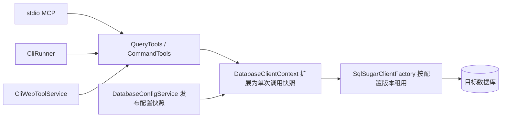

# 数据库工具运行时的性能与架构改进计划

审查基线为 `refactor/vnext` 的 `2732f4d`。范围覆盖 stdio MCP、CLI 和本地 Web 共用的工具调用、查询结果、配置和 SqlSugar 客户端。建议保留当前单进程部署，先从一次调用能读取多少数据、持有哪个客户端、在哪里序列化这三个边界着手。

## 首行查询的实测基线

对同一个 Release/net9.0 stdio MCP 进程调用 `sql_query_single`。使用独立临时 SQLite 数据库，以只读模式连接，表有 100,000 条记录，`id` 为整数主键，`payload` 为 64 个 `x`。三组都校验返回的 `id = 1` 和完整 `payload`。预热一轮，随后交替正序和倒序采集五轮。计时从发出 `tools/call` 到客户端读到响应，排除建库和进程启动。

| SQL 允许返回的行数 | 调用中位数 | 五次测量范围 |
| ---: | ---: | ---: |
| 1 | 1.53 ms | 1.38–1.80 ms |
| 10,000 | 32.34 ms | 26.94–49.36 ms |
| 100,000 | 292.93 ms | 248.89–299.76 ms |

`Tools/Query/QueryTools.cs:70` 对三个输入都先调用 `SqlQuery<dynamic>`，再对集合取 `FirstOrDefault()`。这说明目前连只返回一行的工具也承受后续行的读取和映射成本。数字衡量本机端到端延迟，优化后的收益和其他 provider 的行为需要各自测量。

复测可在临时 SQLite 文件中执行以下建表语句，将测试配置指向该文件，并在同一个 MCP 会话运行下方查询。SQLite 的 `ORDER BY id` 沿整数主键读表，避免额外排序影响对比。

```sql
CREATE TABLE samples (id INTEGER PRIMARY KEY, payload TEXT);
WITH RECURSIVE numbers(id) AS (
    SELECT 1 UNION ALL SELECT id + 1 FROM numbers WHERE id < 100000
)
INSERT INTO samples SELECT id, replace(hex(zeroblob(32)), '0', 'x') FROM numbers;
```

通过 `sql_query_single` 分别执行 `SELECT id, payload FROM samples ORDER BY id LIMIT 1`、`LIMIT 10000` 和 `LIMIT 100000`（后两次仅替换上一句的上限）。对比相同构建模式和相同调用入口，记录响应、延迟和每次调用的分配字节数。上表仅采集延迟。

## 第一批实施与复测（2026-11-18）

`sql_query_single` 在超时回调内打开并释放 reader，只调用一次 `Read()`。它复用 SqlSugar 的 `DataReaderToExpandoObject`，与普通查询共用动态列名、值及数据库空值的映射规则。Web 的工具执行状态和结果共用一次 JSON 解析，SQL 执行日志在 Information 级别启用时才格式化参数。

| 候选行数 | 修改前 net9.0 | 修改后 net9.0 | 修改后 net10.0 |
| ---: | ---: | ---: | ---: |
| 1 | 2.13 ms | 1.19 ms | 1.12 ms |
| 10,000 | 27.21 ms | 1.35 ms | 1.32 ms |
| 100,000 | 321.41 ms | 1.36 ms | 1.23 ms |

同机沿用上一节的 SQLite 数据、Release 配置、stdio 工具入口和采样方法，逐次校验结果。表中为五次调用的中位数。net9.0 的修改前数据来自本轮重新运行的原始构建。此次量化的是端到端延迟；其他 provider 的提前关闭行为及内存分配量仍待单独测量。

`QueryToolsTests` 的首行回归在 SQLite 第二行放置整数溢出表达式，实际读取第二行会失败。同时验证了绑定参数、列名大小写、数据库空值、二进制值和显式超时。空结果返回 `null` 单独验证。`CliWebHostTests` 通过 HTTP 检查工具执行失败时仍返回正确的外层状态和内层结果。全套 159 个测试在 net9.0 通过，net9.0 与 net10.0 均完成 Release 构建和 stdio 基准调用。

资料与版本核对：

- SqlSugarCore 5.1.4.216 安装包中的 `AdoProvider.SqlQuerySingle<T>` 调用 `SqlQuery<T>` 后取首行，动态行列表则逐行调用 `DataReaderToExpandoObject`。核对位置见[上游 AdoProvider](https://github.com/DotNetNext/SqlSugar/blob/master/Src/Asp.NetCore2/SqlSugar/Abstract/AdoProvider/AdoProvider.cs)和[上游 ContextMethods](https://github.com/DotNetNext/SqlSugar/blob/master/Src/Asp.NetCore2/SqlSugar/Infrastructure/ContextMethods.cs)。
- ADO.NET 文档说明 `Read()` 推进到下一行，并说明了及时关闭 reader 对连接使用的影响。[Microsoft Learn · Retrieving Data Using a DataReader](https://learn.microsoft.com/en-us/dotnet/framework/data/adonet/retrieving-data-using-a-datareader)
- .NET 日志文档说明如何通过 `ILogger.IsEnabled` 在日志关闭时跳过计算。[Microsoft Learn · High-performance logging in .NET](https://learn.microsoft.com/en-us/dotnet/core/extensions/high-performance-logging)

## 第二批实施与验证（2026-11-18）

CLI 和本地 Web 的配置修改共用按目标路径独占的 `.lock` 文件。写锁覆盖读取、业务校验、修改和原子发布。初始化、导入、导出在持锁期间检查 `--force`，Web 连接向导在同一次修改中读取数据库类型。读者可继续使用已经打开的旧版本。

Windows 和 Linux 分别以 12 个独立 CLI 进程向同一配置新增连接，并让每个进程将自己的连接设为默认。两次均保留全部 12 条记录，最终均只有一个默认连接。Windows 验证了替换失败时原文件字节保持完整、临时文件清理和受保护的 DACL。Linux 容器验证了替换前后的 UID、GID、0640 权限和指定用户的 POSIX ACL。Windows 的 net9.0 Release 测试共通过 163 项，net10.0 Release 构建成功。

## 实施顺序

| 顺序 | 源码证据（相对于 `src/DatabaseMcpServer`） | 建议与验收 |
| --- | --- | --- |
| 1 · 首行读取 | `Tools/Query/QueryTools.cs:58`。普通查询和首行查询都物化集合。 | [ ] 首行路径使用同一套 SQL 校验和参数绑定，在 timeout 回调内打开 reader、最多映射一行并释放。覆盖空结果、空值、列别名、重复列名、日期、二进制及异常时释放。实测分配量应与候选行数脱钩，并复跑上述三组。客户端提早关闭与数据库端执行计划分别验证。 |
| 2 · Web 结果转换和 SQL 日志 | `Web/CliWebToolService.cs:75` 对同一个 payload 调用 `IsToolFailure` 和 `ParsePayload`，两者分别解析 JSON，随后 HTTP 层再序列化。`Services/SqlSugarClientFactory.cs:113` 在检查日志级别之前已格式化 SQL 和参数。 | [ ] Web 只解析一次，同时提取业务状态与结果，保留纯文本回退；日志先检查 `IsEnabled` 再执行格式化，延续脱敏规则。用大 JSON、业务失败、非 JSON 和禁用 Information 的场景验证。记录 Web 分配和响应大小，分开评估两项收益。 |
| 3 · 配置并发写入 | `Cli/CliConfigWrite.cs` 管理写锁、同目录临时文件与原子替换。 | [x] 读改写和覆盖检查均在锁内完成，已验证跨进程并发、权限保留和发布失败后原文件可读。 |
| 4 · 配置热重载和客户端回收 | `Services/DatabaseConfigService.cs:487` 每次成功重载清空整个缓存。`Services/SqlSugarClientFactory.cs:57` 把已创建的 scope 全部转入 `_retiredClients`，Host 关闭时才释放。反复重载并重新使用连接会持续积累旧 scope。 | [ ] 先按有效连接配置差异复用未变 scope；连接串、DbType 和影响客户端的配置变化时建立新一代。复用已有 `DatabaseClientContext` 的策略快照，危险操作权限变更须对新调用立即生效。[ ] 所有借用方接入有明确结束点的客户端租用机制后，再在最后一个调用释放时回收旧代。测反复重载、在途请求、异常和关闭，记录活动与退役 scope 数量。 |
| 5 · Web 并发和数据库选择 | `Web/CliWebToolService.cs:62` 的单个信号量串行化所有工具调用，`durationMs` 在入锁后才计时。`Web/CliWebHost.cs:196` 的切库端点直接走 `CliWebApiService`。`Tools/Management/ConnectionTools.cs:33` 的连接检查和响应库名分开读取。 | [ ] 先给单次调用捕获库名、类型、策略、客户端所属版本，响应也从同一快照读取。分别记录排队、执行和端到端时间。[ ] 先放开已验证 provider 的独立只读查询并配置并发上限；切库、重载和写入使用明确的协调规则。以两个带不同标记的 SQLite 库做“慢读 A、切 B、读 B”，断言数据、库名和权限一致，并检查写入确认行为。 |
| 6 · 驱动设置的真实性和重复代码 | `Strategies/DBSetting/TidbOptimizationStrategy.cs:53` 解析 `optimizationSettings.maxPoolSize` 后仅写日志；`DatabaseSetting/TiDB.md` 将其列为有效配置。同一策略中 `disableNvarchar` 则写入实际设置。 | [ ] 先逐项标出实际设置、连接串选项和仅提示项，修正说明；需要生效的选项用 provider 支持的机制并明确与显式连接串的优先级。测试断言最终有效设置。仅将验证过的共同解析逻辑提取复用，保留各库独有行为。 |

## 多结果集查询实测（2026-11-18）

`get_data_set_all` 使用驱动生成的列名和类型，序列化时从 `DataTable` 直接写入 JSON，省去每行的字典。SQLite 驱动会去除列名首尾的空白，将重复的 `mixed` 列命名为 `mixed1`，并将声明为 `DATETIME` 的列转换为日期值。直接按 reader 的原始列名建字典的实验在重复列名输入上报错。

Windows x64、Release/net9.0，沿用文首的 SQLite `samples` 表。依次读取前 50,000 行、一个空结果集和后 50,000 行。非空结果集均返回按主键排序的 `Id`、64 字符的 `Payload` 和空值 `Missing`。每个样本使用新进程，在同一 Host 上预热小查询，计时覆盖调用及最终 JSON 字符串生成。记录 5 次的中位数。峰值使用返回后、校验前读取的 `Process.PeakWorkingSet64`，包含进程启动和预热。分配量使用调用前后的 `GC.GetTotalAllocatedBytes(true)` 差值。

| 读取与序列化方式 | 耗时 | 进程峰值工作集 | 托管分配量 |
| --- | ---: | ---: | ---: |
| DataSet 转逐行字典（原实现） | 769.8 ms | 180.5 MiB | 133.6 MiB |
| DataSet 直接写 JSON（本次交付） | 599.9 ms | 156.9 MiB | 104.2 MiB |
| reader 转逐行字典（实验） | 477.3 ms | 154.3 MiB | 102.6 MiB |

对三组的每次调用均校验了行数。此数据集的 15 份 JSON 的 SHA-256 完全相同。回归测试另覆盖重复列名、二进制、数据库空值、空结果集、参数和非 ASCII 文本。基准衡量本机 SQLite，最终 JSON 字符串及驱动的 `DataSet` 仍占用内存。

## 建议的运行时边界



先在现有项目内整理边界。工具注册已有 `DatabaseMcpToolCatalog` 作为共享来源。结果传输先做 Web 单次解析，待更多入口需要复用业务结果时，再让应用层返回具名结果、由各入口完成最后一步序列化。配置路径也适合由 Host 解析后注入，逐步替换 `CliRunner.cs:336` 与 `CliWebHost.cs:76` 借用进程环境变量传递一次调用配置的做法。

## 验证与回滚

- [ ] 在仓库根目录运行 `dotnet test 'tests/DatabaseMcpServer.Tests/DatabaseMcpServer.Tests.csproj'`。当前测试目标为 net9.0，生产项目同时面向 net9.0 和 net10.0，可用 `dotnet build 'DatabaseMcpServer.slnx' -c 'Release'` 验证构建，再在两个目标上各执行一次 stdio 冒烟。
- [ ] 契约基线包含 MCP 工具名和参数、CLI 退出码、Web 的 `success` / `toolSuccess`、每连接危险操作许可、超时隔离、批量部分成功、手动与监听触发的默认库选择。用真实工具入口比对同一输入的 JSON。
- [ ] 将首行、JSON、日志、配置写入、客户端生命周期和并发策略分成可独立回退的小改动。先交付单次调用快照，再开启只读并发。若回退，先恢复串行调度，再回退租用实现，以免在途调用引用已释放的客户端。
- [ ] 把 `SqlSugarClientFactoryTests.cs:57` 的私有字段反射断言改为观察复用、旧请求可完成和最终释放。性能验收区分机器、运行时、provider、预热条件和负载，用本机基线比较变化。
