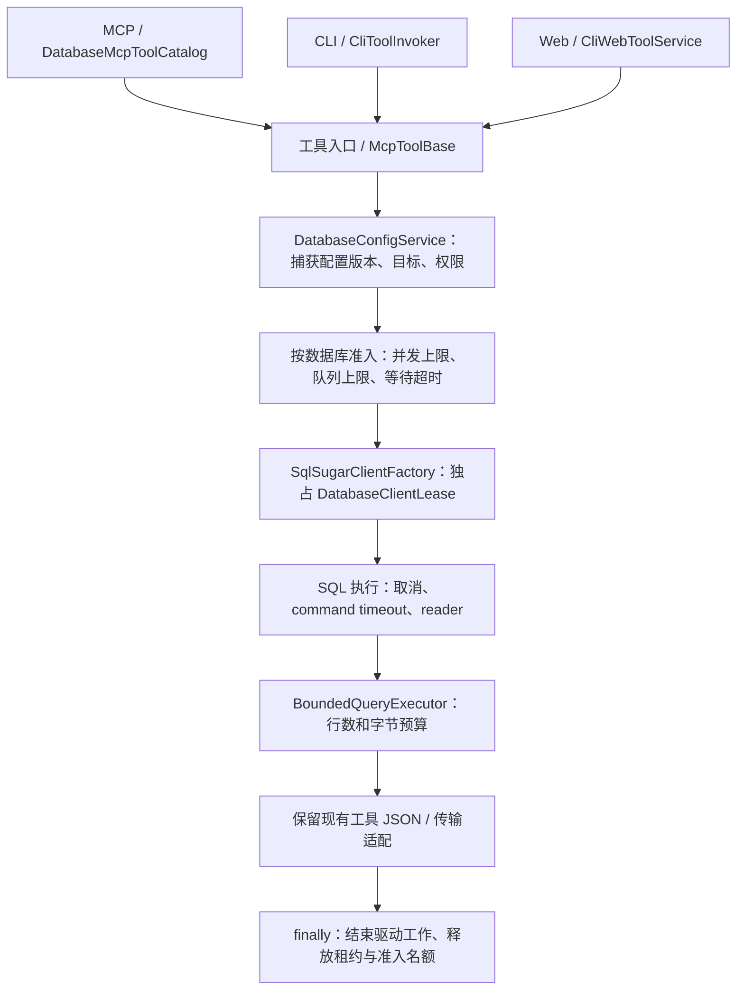

# MCP 执行与资源管理全面优化计划

日期：2026-11-19。核查基线：`70427f7`；开始核查时工作区干净。

状态：用户授权后于 2026-11-19 至 2026-11-20 实施。六个阶段的本地实现已落地；复选框与文末记录区分已验证内容和尚未完成的 provider/性能验证。全过程由主助手完成，未使用子智能体，未提交、发布或操作真实业务数据库。

## 目标与范围

优先改善 MCP 调用的正确性、可取消性、资源上限和内存开销，CLI/Web 共用这些能力。保持现有工具发现、参数绑定、SQL 安全检查、默认查询结果和配置文件兼容。配置编辑可靠性、诊断解耦及前端加载作为后续阶段，避免在执行层尚未稳定时同时扩大改动。

本轮不升级 MCP/SqlSugar 依赖，不切换传输协议，不引入通用框架或拆分程序集。生产项目当前为 net9.0/net10.0，ModelContextProtocol 2.0.0、SqlSugarCore 5.1.4.216；测试当前只有 net9.0、xUnit 2 + VSTest。主机已安装 net9/net10 运行时。

## 已核实的问题

| 问题 | 代码依据 | 影响 |
| --- | --- | --- |
| 查询仍同步执行，MCP 工具方法未接收取消令牌 | `Tools/Query/QueryTools.cs`、`Helpers/BoundedQueryExecutor.cs` | 请求取消不保证数据库停止；读取和编码也不能及时中断 |
| Web 只对排队等待传递取消，异常统一包装 | `Web/CliWebToolService.cs` | 执行中的取消无法下传，取消可能被识别为普通失败 |
| CLI 按方法参数逐个构建公开选项，直接反射调用 | `Cli/CliToolMetadata.cs`、`Cli/CliToolInvoker.cs` | 直接增加 CancellationToken 或改方法名会改变 CLI/Web 参数或工具名称 |
| 工具基类和批量查询捕获所有异常 | `Tools/McpToolBase.cs`、`Helpers/BoundedQueryExecutor.cs` | 取消可能转成 UnknownError，批量取消后仍执行后续 SQL |
| 客户端池只限制空闲数量，创建和释放位于全局锁内 | `Services/SqlSugarClientFactory.cs` | 活动客户端无上限，驱动操作放大锁竞争 |
| 配置锁内租用客户端，外部能拿到可变配置对象 | `Services/DatabaseConfigService.cs` | 增加异步排队后容易串库、绕过配置校验或出现锁生命周期问题 |
| 每行 writer/stream/byte[]，然后再次合并序列化 | `Helpers/BoundedQueryExecutor.cs` | 有限查询仍有大量短期对象与复制 |
| 自定义 timeout 通过 CopyNew 创建额外客户端 | `Helpers/SqlCommandTimeout.cs` | 新租约路径存在可减少的创建/释放；旧共享路径仍需要隔离 |
| 页面先 rename 再 update，失败重试保留旧 sourceName | `website/src/composables/useConfigWorkbench.ts` | 已成功重命名后，后续更新失败难以安全重试 |
| 页面按磁盘配置推导当前数据库 | `Web/CliWebApiService.cs` | 保存成功、运行时应用失败时显示可能与执行目标不一致 |
| Web 调用 CLI 业务并解析 JSON；诊断修改全局 Console | `Cli/CliConfigCommandHandler.cs`、`Cli/CliRunner.cs`、`Web/CliWebApiService.cs` | 入口耦合、重复序列化和并发输出干扰 |

依赖实现证据：上一轮保存在 `.git/testagent/runtime-20261119/AdoProvider.cs` 的反编译结果中，`GetDataReaderAsync`/`GetScalarAsync` 将 `Ado.CancellationToken` 传给驱动；`GetDataSetAllAsync` 却使用 `Task.Run` 包装同步方法。实施时重新确认当前安装 DLL 与该证据一致。不能通过方法名带 Async 推断取消已经生效。

## 目标调用流与不变量



1. 取消信号从 MCP SDK、Web RequestAborted、CLI Ctrl+C 进入同一执行路径；取消不伪装成成功、普通 SQL 错误或数据库配置错误。
2. 取消响应不等于驱动已结束。SQL/reader 尚未结束时不得归还客户端、释放执行名额后任由后台查询继续，或将客户端交给下个请求。
3. 每次数据库操作在首次异步等待之前捕获完整、不可变的目标快照，包含数据库名、连接配置、权限与配置版本；同一请求不再次读取全局当前数据库。切库只影响随后接纳的调用。
4. 排队引用必须保留对应配置版本；重载可以退休旧版本，但不能在已有请求尚待执行时销毁它。shutdown、排队取消、初始化失败都应释放引用。
5. 并发限制不能因配置重载而翻倍：版本不同的同一逻辑连接仍共享准入名额；重命名迁移其准入身份。独立配置项指向相同物理数据库时不自动合并，文档明确限制按配置连接计算。
6. 独占租约只归还一次；旧公共 CreateClient/默认接口兼容路径不能假设独占。取消令牌、超时、事务、CommandType 等状态不得泄漏给下一次租用。
7. 不在配置锁或客户端池锁内等待 Semaphore、驱动 I/O、执行用户回调或 Dispose。锁只保护元数据；版本引用防止释放锁后的退休竞争。
8. 保留已有 MCP/CLI 名称和参数语义。CancellationToken 属于注入参数，不进入工具 schema、CLI help 或 Web 参数表。实际名称以 SDK tools/list 基线为准，不假设与 CLI snake_case 一致。
9. 保留 maxRows/maxResponseBytes 的可选语义、完整 UTF-8 JSON、无 N+1 读取、跨 batch/result sets 共享预算，以及 truncated 的三态含义。
10. 写操作取消不承诺自动回滚；只有明确事务边界且回滚成功才能报告回滚。提交结果不确定时不自动重试写操作。

## 阶段 1：锁定契约与验证基线

涉及：`tests/DatabaseMcpServer.Tests/`、测试 csproj、`Extensions/DatabaseMcpToolCatalog.cs`，按需增加独立 CI 校验 workflow。

- [x] 运行当前全量测试与 Release 构建，记录当前测试数量、框架和结果；上一轮 239 项与前端 12 项仅作历史信息。
- [x] 用真实 MCP SDK 客户端通过测试内传输或隔离 stdio 子进程验证 tools/list 和 tools/call；保存公开工具名、参数、默认值、readOnly/destructive 注解、正常及错误 payload 的契约断言。
- [x] 保留 CLI/Web 现有契约断言。禁止只通过反射调用方法就声称验证了 MCP 协议取消。
- [x] 测试项目改为 net9.0/net10.0，移除 ProjectReference 的固定 net9.0 设置，使每个测试框架引用同目标生产代码。记录各框架独立结果。

验收：现有行为基线通过；测试本身的断言覆盖可观察行为；不因异步迁移悄悄改工具名或暴露注入参数。

## 阶段 2：取消与超时贯穿调用链

涉及：`Tools/Query/QueryTools.cs`、`Tools/Command/CommandTools.cs`、`Tools/McpToolBase.cs`、`Helpers/SqlCommandTimeout.cs`、`Helpers/BoundedQueryExecutor.cs`、`Filters/McpExceptionFilter.cs`、`Cli/CliToolMetadata.cs`、`Cli/CliToolInvoker.cs`、`Cli/CliRunner.cs`、`Web/CliWebToolService.cs`。

- [x] 先建立 provider 能力表，分别记录执行、读取、NextResult 和 Cancel 支持；SqlSugar 异步入口可能仍有同步连接打开/映射，逐段核查。不能用 Task.Run/WaitAsync 作为正在执行 SQL 已被取消的证明。
- [x] 给查询入口增加 SDK 注入的 CancellationToken；CLI/Web 绑定时按 MethodInfo 的真实参数位置注入，公开元数据排除它。如内部方法改为 Async 后缀，显式保留 MCP 名称并让 CLI catalog 保留旧名称。
- [x] 先迁移普通/IN/single/scalar/batch 查询。reader 支持 DbDataReader 时使用带令牌的 ReadAsync/NextResultAsync；前后检查取消，保留原映射、参数展开、日志与安全检查。
- [x] 多结果集不能直接替换为 GetDataSetAllAsync。SQLite 先验证原有限模式映射；其他 provider 只有通过类型与取消合同验证后才走新 reader 路径。旧支持范围保留并如实标明执行中取消限制，不静默禁用已有查询能力。
- [x] 核查需要显式 DbCommand.Cancel 的 provider；若增加命令适配器，保留 SqlSugar 参数绑定、IN 展开、事务和 AOP 行为，不能通过临时读取 Connection 猜测等价。
- [x] 批量循环在每条 SQL 前检查取消，取消后停止后续查询。普通 SQL 错误继续保留现有逐项失败语义。
- [x] 请求取消的 OperationCanceledException 透传至 SDK/HTTP 生命周期；超时与主动取消分别处理。检查反射异常解包，避免统一转成 InvalidOperationException。
- [x] 独占路径在 try/finally 内设置并恢复 Ado.CancellationToken、CommandTimeOut 等状态，失败且无法确认可复用时废弃客户端。共享兼容路径保留隔离策略，不能直接删除 CopyNew。
- [x] 显式保留 timeout=null 使用原默认、0 无限等待、最大 86400 秒的既有语义。排队等待超时独立于 SQL command timeout。
- [ ] 写命令/事务/存储过程分批迁移，验证取消时回滚、输出参数和 CommandType 恢复；管理/Schema 的同步驱动入口明确列出边界。

验收：预取消不执行 SQL；排队取消不占连接；执行中/读取中取消可观察到驱动结束；后续请求正常；batch 后续 SQL 未执行；超时及取消状态不污染下一次租约。使用同步屏障和可控驱动替身验证生命周期，并用真实测试数据库验证驱动行为，避免靠 Sleep 猜测时序。

## 阶段 3：请求快照、并发上限与连接池锁

涉及：`Services/DatabaseConfigService.cs`、`Services/SqlSugarClientFactory.cs`、`Interfaces/IDatabaseConfigService.cs`、`Interfaces/ISqlSugarClientFactory.cs`、`Models/DatabaseClientLease.cs`、`Models/DatabaseRuntimeOptions.cs`、组合入口及各工具租用点。

- [x] 内部发布不可变配置快照，公开返回 DatabaseConnection 时复制嵌套 OptimizationSettings，不能仅复制 List。
- [x] 建立异步准入与租约获取，数据库目标/权限/版本在等待前固定。适配查询、命令、Schema 和批量连接检查，不能只有 Web 或只读查询受限。
- [ ] 初始候选限制为每配置连接 8 个执行、32 个排队、30 秒排队超时，并提供可验证的运行选项；以压力测试确定最终值和文档。队满快速返回明确繁忙错误，排队令牌可取消。空闲 16 个与活动上限是不同概念。
- [x] 新增参数解析/验证集中在运行选项，避免在工具内部重复读环境变量。同步旧接口明确兼容行为与资源保证范围。
- [x] 池内先锁定版本/租用状态，再于锁外创建客户端；创建失败、Dispose 并发、重载及重复归还必须配对回收名额与版本引用。
- [x] Retire/Reset/Dispose 在锁内摘取待释放对象，锁外调用驱动 Dispose；旧 scope 兼容生命周期保留，不能释放不受租约追踪的活动用户。
- [x] 配置版本引用与准入生命周期统一处理 reload、rename、shutdown，防止旧快照重新进入当前池和无限保留空的准入条目。
- [x] 完成所有数据库工具目标固定后，按只读、写入及配置管理分类逐步放开 Web 全局锁；未验证的写/管理操作仍保留必要串行。更新说明：共享默认选择不等于每个客户端独立会话。

验收：不同数据库互不阻塞；同数据库执行数与排队数不超限；等待时切库/重载/改权限后按已接纳快照执行；重命名/重载不突破总活动上限；异常、取消、shutdown 后引用与名额归零；双框架并发测试通过。

## 阶段 4：结果编码与内存分配

涉及：`Helpers/BoundedQueryExecutor.cs`、`Services/JsonResultSerializer.cs`、查询结果模型、按需调整 Web payload 适配。

- [x] 在相同行数、列类型、字节量和预算下记录基线；分开报告 SQL 执行、编码、端到端耗时、托管分配与进程峰值。（本地操作级测量，不含 MCP/HTTP 封装；见交付记录）
- [x] 优先采用请求内复用受限缓冲和 writer，使用完整行检查点与回退；减少每行 stream/writer/ToArray 和逐字段 Flush，保留超大字段提前检查。
- [x] 若合并为单个请求缓冲，行拒绝、batch 单项失败、预算耗尽必须恢复字节/行计数和 JSON writer 状态，保留合法响应骨架；不要仅回退 stream.Position 就复用错误 writer 状态。
- [x] 只有测量显示收益时再引入 ArrayPool。若使用，响应序列化完成前不得归还缓冲，异常/取消路径也必须清理；避免引用过期内存。
- [x] 类型化结果留在内部服务，MCP 外部 string JSON 合同保持。Web 避免无必要的重复解析，但不可为减少一次解析而改变 success/toolSuccess 或响应对象类型。
- [x] 保留 limitReached/truncated/rowCount/skippedQueries 的语义和描述，引导客户端缩小列集合、分页或过滤。没有稳定排序和一致性机制时不新增伪续传 cursor。

验收：UTF-8 边界、中文/转义、二进制、DBNull、decimal、日期、重复别名、空结果、多结果集、取消和预算边界测试通过；绝不读取第 N+1 行。相同结果基准确认分配下降，并报告时间差异；未见收益的复杂改法不保留。

## 阶段 5：配置编辑与运行时一致性

涉及：`Web/CliWebApiService.cs`、配置编辑 helper、`Services/DatabaseConfigService.cs`、`website/src/composables/useConfigWorkbench.ts`、相关响应类型和界面。

- [x] 先修复两步保存：rename 完成或返回 saved=true 后同步编辑身份，update 重试使用实际名称；避免未等待的 dashboard 刷新覆盖新编辑状态。
- [x] 抽取共享配置编辑应用服务，重命名与属性更新在完整候选上一次校验、一次配置文件保存，再分别应用运行时与持久化选择。
- [x] 保留原 rename/update 接口为适配入口；Web 编辑调用组合操作。跨配置/选择状态文件只报告部分成功，不声称具备跨文件事务，不盲目回滚已保存配置。
- [x] Dashboard 明确返回已保存配置版本、运行中版本/当前数据库、应用状态；缺少有效运行时或初始化失败时返回明确状态。禁止把磁盘默认值当作实际运行中目标。
- [x] 配置快照版本不能泄露连接串或密码；错误及日志沿用现有脱敏。保留本地 Web 写请求保护。

验收：rename 成功/update 失败后重试成功；saved=true/runtimeApplied=false 的身份及状态正确；刷新竞争不覆盖用户新输入；外部状态变化与实际运行目标可区分；空配置仍可打开管理页面。

## 阶段 6：共享服务、前端加载与交付验证

涉及：CLI/Web 配置与诊断入口、按需新增 `Services/` 契约、`website/src/App.vue`、测试与 CI、`TOOLS.md`、`Doc/cli.md`。

- [x] CLI/Web 业务入口依赖同一个配置应用服务及类型化结果，各自在边界格式化输出。只抽取已有重复业务，不建设泛型命令总线。
- [x] 诊断复用现有配置校验和依赖，注入输出/日志，移除生产调用链的进程级 Console.SetOut/SetError 重定向及无必要嵌套 Host。MCP stdio stdout 只承载协议，CLI JSON stdout 保持可解析。
- [x] ToolPlayground 采用异步组件导入，验证实际产物分块与首屏下载下降；保留已挂载页面状态和切换后的查询结果。无需以消除所有 Vite 警告为目标重写 UI。
- [x] 增加不触发发布的 CI 验证，net9/net10 测试与前端检查；真实 MySQL/PostgreSQL/SQL Server 测试仅使用隔离测试实例和显式测试凭据。未运行的驱动测试列为未验证，不算通过。
- [x] 补充运行限制、繁忙/取消/超时行为、provider 能力矩阵、输出预算及兼容说明，更新内嵌 Web 构建产物。
- [x] 最终人工复核资源生命周期、取消竞态、配置部分成功和秘密泄露风险，记录实际测试数与 benchmark。

## 验证命令

当前仓库核查为 xUnit 2 + VSTest，未发现 run-tests overlay、Directory.Build.*、Directory.Packages.* 或 runsettings。以下为可复现验证命令，实际结果见文末。

实施前基线，在仓库根目录：

```powershell
Set-Location -LiteralPath 'D:\Demo\my-mcp\DatabaseMcpServer'
dotnet test 'tests/DatabaseMcpServer.Tests/DatabaseMcpServer.Tests.csproj' -c 'Release' --framework 'net9.0'
dotnet build 'DatabaseMcpServer.slnx' -c 'Release'
```

测试项目完成多目标改造后，最终分别执行并记录两个结果：

```powershell
Set-Location -LiteralPath 'D:\Demo\my-mcp\DatabaseMcpServer'
dotnet test 'tests/DatabaseMcpServer.Tests/DatabaseMcpServer.Tests.csproj' -c 'Release' --framework 'net9.0'
dotnet test 'tests/DatabaseMcpServer.Tests/DatabaseMcpServer.Tests.csproj' -c 'Release' --framework 'net10.0'
dotnet build 'DatabaseMcpServer.slnx' -c 'Release'
git diff --check
```

前端变动时：

```powershell
Set-Location -LiteralPath 'D:\Demo\my-mcp\DatabaseMcpServer\website'
npm test
npm run build
```

性能验证使用固定数据集与并发档位 1/8/32，预热后重复采样并报告 P50/P95、吞吐、分配量、活动/排队数和取消至资源释放延迟。纯编码与数据库端到端分别测试；多线程异步路径不以单线程分配计数代表整次调用。响应内容做等价校验，不能以少返回数据证明同等工作更快。

## 实施顺序与回退

阶段 1 → 2 → 3 → 4；阶段 5 → 6 在核心调用链稳定后实施。每阶段可独立审查、验证，基线失败时先定位原因；不混入包升级或大规模格式化。

- 异步路径保留已验证的旧 provider 行为边界，未验证能力不默认启用。失败时回退本阶段实现，保留已有工具契约与安全检查。
- 连接池生命周期回退需要停止接纳新调用并排空已有/排队引用，不能在活动执行中直接换工厂或释放全部实例。
- 结果编码先保持旧预算合同；若出现映射或预算差异，回退新编码，不放宽预算静默绕过。
- 配置部分成功保留实际已保存数据；不为回退 UI 恢复整份旧配置，避免覆盖并发编辑。
- 仅回退本轮相应 diff，不使用 reset --hard，不改变用户暂存状态；不自动提交或发布。

## 新会话执行指令

按 `plans/2026-11-19-mcp-execution-optimization.md` 分阶段实施全面优化，不使用子智能体。先重新核对 git 状态和当前版本，执行基线，再完成阶段对应代码、测试、文档与性能对照。保留用户修改；公开工具名称、参数、SQL 安全与响应合同兼容。对不支持或未验证的 provider 明确报告边界，不能以 Task.Run 代替执行中取消。完成后报告实际修改、双框架及前端验证、性能数据和剩余限制。

## 执行记录（2026-11-20）

- 基线：net9 原有 239 项通过，Release 构建通过。最终：net9 / net10 各 265 项通过、无失败/跳过；Vue 16 项通过，Release 构建 0 errors。
- 六阶段落地：查询/普通写命令取消、按连接有界准入和版本租约、writer/stream 复用、组合配置编辑与运行版本、共享诊断/移除 Console 重定向、工具面板延迟加载及独立 CI。
- 最终复核额外修复：已删除目标仍有请求时不能覆盖其额度；保存后应用暂缓的 rename 在 reload/再次 rename 时保留源额度；文件损坏/缺失不隐藏实际运行目标；旧保存完成不覆盖新编辑。
- 原计划两项仍部分完成：存储过程/GO/完整多结果集和 schema 保留同步驱动行为，缺少真实 provider 等价性与取消验证；默认 8/32/30 已配置并验证 1/8/32 档名额与排队，但生产容量调优待真实隔离实例。没有可用的 MySQL/PostgreSQL/SQL Server 测试凭据，未连接业务数据库。
- 性能：相同 10,000 行结果，有限查询分配约下降 57%–63%；分离 SQL、行编码与并发 1/8/32 对照和峰值记录见 [交付记录](../Doc/execution-optimization.md)。并发吞吐并非普遍提高，不声称进程峰值降低。
- MCP 显式取消通知验证通过；当前 SDK 客户端仅本地 token 取消未可靠传到服务端，根因未确认，保留边界说明，不以本地等待取消冒充数据库取消。
- 已保存完整验证命令、需求/测试映射、provider 矩阵和依赖审计告警至 [Doc/execution-optimization.md](../Doc/execution-optimization.md)。远端 CI 未运行，无提交/发布。
