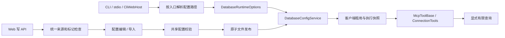

# 运行时一致性、Web 写接口保护与资源预算实施计划

日期：2026-11-19。工作区：`D:/Demo/my-mcp/DatabaseMcpServer`，当前分支：`refactor/vnext`。

状态：用户已明确授权实施；六个阶段已落实，由主代理直接完成，未使用子智能体。下文保留原设计检查表，实际实现差异、验证证据与限制见末尾执行记录。

## 目标与基线

完成上一轮分析中的六项工作：重命名当前连接时保持选择、统一 Web 写接口保护、共用配置校验并报告生效状态、及时回收失效客户端、为大查询提供可选资源预算、通过 DI 注入配置路径。

工作区已有多轮未提交的修改。执行时以当前文件内容为基线，保留这些修改；不要重置到 HEAD，也不要重复实现已有功能。上轮报告的基线是 180 项测试通过及 net9.0/net10.0 Release 构建成功，本计划阶段没有重新运行这些检查。

已核实的代码事实：

| 问题 | 当前路径与行为 |
| --- | --- |
| 重命名与选库脱节 | `Web/CliWebApiService.RenameDatabase` 先修改配置及状态文件，再调用重载。`DatabaseConfigService` 仍持有旧名称，找不到后会回退到默认库并再次写状态。 |
| 写接口保护不一致 | `Web/CliWebHost` 只在 `/api/tools/{toolName}/invoke` 检查请求标记和 Origin；设置默认库、导入等写入口未共用检查。 |
| 校验与生效反馈脱节 | `CliConfigCommandHandler.BuildValidationReport` 拒绝重名，运行时却通过 `connections[db.Name] = db` 覆盖；Web 重载返回值和异常被忽略。 |
| 旧客户端长期存留 | `SqlSugarClientFactory` 将变化的 scope 放入 `_retiredClients`，只在 Host 关闭时释放；公共 `CreateClient` 明确约定返回共享且调用方不能释放的对象。 |
| 查询缺少限额 | `QueryTools.SqlQuery`、IN 查询和批量查询物化完整列表；多结果集仍构造完整 DataSet。 |
| 进程级状态耦合 | `CliRunner`、`CliConfigCommandHandler`、`CliWebHost` 都临时修改 `DB_CONFIG_PATH`；监视器的启动回退也重新读取环境变量。 |

路径除特别注明外均相对 `src/DatabaseMcpServer/`。此前临时 Web 复现命令被自动审批拒绝，不把源码判断表述为已经完成 HTTP 验证。

## 必须保持的不变量

- MCP 工具名称、现有参数、SQL 安全检查、参数绑定、危险操作权限和超时隔离保持有效。
- 未传查询预算参数的调用保留现有结果形状和完整结果行为。资源预算只影响显式启用的调用。
- 手动重载保留最新选库；监视器仅在文件默认库确实变化时跟随。重载读文件期间普通切库仍可进行。
- 配置文件与状态文件沿用现有按路径跨进程锁和原子替换。不能承诺两个文件及运行时的跨进程原子事务；部分成功必须有明确反馈。
- 正常读配置和运行时使用同一套内容校验规则；空配置可以作为初始化产物保存，但不可执行数据库工具。
- 在途请求只能使用取得时所属版本的客户端、类型、库名和权限，不能因重载而访问已释放对象。
- 单个 Host 的配置路径在构造时确定，环境变量仍是入口解析来源之一，不能在重载时把 Host 改绑到别的路径。
- 保留已有未提交工作，不创建提交或分支；执行过程不使用子智能体。

## 方案比较

| 方案 | 做法 | 取舍 |
| --- | --- | --- |
| A：沿现有服务逐步改造（推荐） | 注入路径、提取内容校验、增加受协调的重命名操作和客户端租用、为显式有限查询增加 reader 路径。 | 配置格式不迁移，工具契约兼容，分阶段可回退；必须完整审计租用调用方和有限查询的驱动映射。 |
| B：重建调用会话与持久化模型 | 连接增加稳定 ID，全部操作走新的调用会话和配置仓储，每次调用创建独立客户端。 | 可统一所有边界，但涉及配置和状态迁移、公共 API 行为变化以及客户端初始化成本；本轮影响面过大。 |

选择 A。以现有服务为实现落点，仅提取确实共享的校验、文件编辑和请求保护逻辑。客户端内部优先采用租用计数；旧的无租用公共 API 需要显式兼容路径，不能悄悄变成要求调用者 Dispose 的接口。



## 阶段 1：固定每个 Host 的配置路径

文件：`Models/DatabaseRuntimeOptions.cs`、`Hosting/DatabaseHostBuilderFactory.cs`、`Extensions/ServiceCollectionExtensions.cs`、`Services/DatabaseConfigService.cs`、`Services/DatabaseConfigFileMonitorService.cs`、`Cli/CliRunner.cs`、`Cli/CliConfigCommandHandler.cs`、`Web/CliWebHost.cs`。

- [ ] 给运行选项添加已解析的绝对配置路径，作为可选构造参数传递，保留现有调用兼容性。
- [ ] CLI `tool`、`config test`、`config doctor` 和 Web 将入口解析结果直接注入；移除这些路径为传配置而进行的 `SetEnvironmentVariable` 及恢复操作。
- [ ] stdio 沿用自己的路径解析顺序，初始化时固定结果。明确配置文件不存在时的失败与 Web 初始化流程，不能改成隐式选另一个文件。
- [ ] 监视器在配置尚不存在或服务初始化失败时，使用同一个已解析目标路径监听。
- [ ] 不把日志重定向重构混入本阶段；现有 `Console.SetOut/SetError` 仍是独立的全局状态限制，Host 路径隔离的结论不能扩展为任意并行 CLI 都已安全。

验收：同进程启动两个不同配置的 Web Host，分别初始化、切库、重载和关闭，互不改绑；变更进程环境变量后已启动 Host 仍用原路径；显式不存在路径不偷偷回退；空配置启动与随后添加连接仍正常。

## 阶段 2：统一内容校验与保存/生效反馈

文件：新增 `Helpers/DatabaseConfigurationValidator.cs`；修改 `Cli/CliConfigCommandHandler.cs`、`Cli/CliConfigFileService.cs`、`Services/DatabaseConfigService.cs`、`Web/CliWebApiService.cs`、`Web/CliWebApiModels.cs`，按需调整 `Models/ConfigurationReloadResult.cs` 及 Web 响应类型。

- [ ] 从 `BuildValidationReport` 提取纯内容校验，检查 null 条目、空名称、按现有 Ordinal 规则重名、空连接串、不支持的 DbType 和多个默认库。DbType 支持列表复用现有解析规则，避免再维护一份名称列表。
- [ ] 初始化、配置编辑、导入允许合法空列表；运行时要求至少一个有效连接。这是同一校验器的明确调用选项。
- [ ] CLI `validate`、`doctor`、编辑写入前、导入发布前以及运行时快照发布前复用校验。读取坏文件供诊断/修复的功能不能被底层 Load 一概拦截。
- [ ] 对现有坏配置允许通过删除或修复后成为有效文档；仅在最终候选内容有效后发布。无效导入不得替换原配置。
- [ ] 把 Web 的无返回值 `TryReloadRuntimeConfiguration` 改为返回结构化操作结果，分开描述 `saved`、`runtimeApplied`、涉及选库时的 `selectionPersisted`。
- [ ] 完成所有必要步骤才返回 `success=true`。已保存但重载失败时返回 `success=false, saved=true, runtimeApplied=false` 和可理解的错误，保留最近有效运行时快照。
- [ ] Web 初始化空配置属于成功的配置编辑，明确标识尚无可用运行时，不伪造加载成功。页面须展示保存未生效提示，不能只弹“成功”。

验收：重名、多个默认库、无效类型、null 条目在 CLI、Web 和重载中的判断一致；校验失败不改变文件或有效客户端；写入成功后故意令重载失败，响应及界面明确表示部分成功。

## 阶段 3：重命名与当前选择一起协调

文件：`Services/DatabaseConfigService.cs`、`Interfaces/IDatabaseConfigService.cs`、`Services/CurrentDatabaseStateStore.cs`、`Interfaces/ICurrentDatabaseStateStore.cs`、`Web/CliWebApiService.cs`、`Cli/CliConfigCommandHandler.cs`；将需要共用的连接改名编辑提取为小型配置编辑操作，运行时服务不调用 CLI 命令字符串。

- [ ] 增加专门的改名应用操作，由运行时协调“取得当前选择 → 持锁读改写文件 → 发布已校验快照 → 保存所需选择 → 返回结果”。避免 Web 先写盘、等监视器介入后再补一次 Switch。
- [ ] 改名操作与重载共用 `_reloadLock`，与切库共用 `_selectionWriteLock`。固定顺序为 reload → selection → 文件写锁；`_stateLock` 仅用于短暂取得/发布内存快照，不能在其内等待文件锁。
- [ ] 普通重载仍在取得 selection 锁前读文件，保留此前“读文件期间切库”的行为。禁止新增反向取锁的路径。
- [ ] 若改名时当前选择正是旧名称，将其映射到新名称；若用户已经切到其他连接，保留该选择。默认标记与文件中其他内容按原改名语义保留。
- [ ] 状态文件提供按配置路径的条件改名：在同一次跨进程读改写锁内，仅当已保存名称等于旧名称时替换，避免覆盖另一进程已经保存的不同选择。
- [ ] 区分未写盘失败、已保存未发布、已应用未持久化的结果；不可用盲目恢复整个旧配置文件处理失败，以免覆盖其他进程的修改。
- [ ] 后续监视器事件读取相同内容时不再次把选库回退。针对已应用内容更新监视器的去重依据时，使用实际发布快照的内容版本。

验收：当前非默认库 A→B 后，运行时和新 CLI 进程均选 B；非当前连接改名不影响选择；默认库改名、同名改名、目标名冲突、监视器先后触发、并发切到 C、状态写失败均有可控时序的验证。

## 阶段 4：所有 Web 写 API 共用请求保护

文件：`Web/CliWebHost.cs`，可新增 `Web/LocalWebRequestGuard.cs`；`website/src/api/http.ts`、`website/src/composables/useConfigWorkbench.ts` 和相关 HTTP 测试。

- [ ] 在 `/api` 的写请求执行前统一检查。覆盖 POST/PUT/PATCH/DELETE，包括不需要 JSON 请求体的 set-default、DELETE，以及 multipart import。
- [ ] 所有写请求要求 `X-DatabaseMcp-Web: 1`；提供 Origin 时必须与请求实际 scheme/host/port 匹配，拒绝无效、多值、`null` 及跨源 Origin。无 Origin 的本地程序仍须提供标记。
- [ ] 验证 Host 只接受 localhost 或回环地址，防止任意 Host 值让来源比较失去意义；正常本地浏览器的 loopback/localhost 访问要有测试。
- [ ] JSON 内容类型和 1 MiB 工具请求上限仍属于工具调用入口。导入保留 multipart 协议，不套用 JSON 限制。
- [ ] 前端统一为所有写请求附标记。当前 `deleteJson` 没有 body，现有 http.ts 不会为其附标记，需要一起调整；multipart 导入现已有标记，继续保留。
- [ ] 错误返回统一为 HTTP 403 与可读 JSON；检查必须早于服务解析、文件读写和数据库操作。

验收：真实 loopback 测试 Host 上，带合法标记的正常写请求成功；缺标记、外部 Origin、伪造 Host、multipart 跨源以及无 body 的跨源 set-default 都不能修改文件、默认库或持久化选择。只使用临时配置和本地测试库。

## 阶段 5：客户端租用与失效版本回收

文件：`Services/SqlSugarClientFactory.cs`、`Interfaces/ISqlSugarClientFactory.cs`、`Services/DatabaseConfigService.cs`、`Interfaces/IDatabaseConfigService.cs`，新增独立的 `Models/DatabaseClientLease.cs`；`Tools/McpToolBase.cs`、`Tools/Management/ConnectionTools.cs`、`Cli/CliConfigCommandHandler.cs`。

- [ ] 使用独立、不可复制的 IDisposable 租用句柄，包含执行快照与一次性释放回调；不要把可 `with` 复制的现有 record 直接作为拥有释放权的句柄。
- [ ] 缓存条目记录活动租用数、是否失效、是否已释放。重载撤销缓存引用；失效且租用数为零时才释放，每个客户端最多释放一次。
- [ ] 全部内部工具使用租用入口。覆盖 McpToolBase 的普通/命名/context/async 路径，ConnectionTools 的健康检查和完整重试循环，以及 config doctor；序列化仍依赖结果资源时，句柄要覆盖序列化结束。
- [ ] 有显式超时的 `CopyNew()` 继续单独释放；租用仍覆盖其整个使用过程，不能因异常漏释放或重复 Dispose。
- [ ] 保留公共旧 `CreateClient` 的共享返回约定：被旧 API 暴露的版本标记为兼容保留，延续 Host 关闭时释放。所有项目内生产调用迁移到租用后，应不再产生这类保留版本。不能声称任意第三方旧调用也能及时回收。
- [ ] Host 关闭后拒绝新租用；先停止/等待已知工作入口，在途租用随后释放失效版本。验证重载、关闭与最后一次归还的竞态。
- [ ] 在启用自动回收前核查 SqlSugarScope 在不同线程/异步上下文中的 provider 持有与 Dispose 行为。仅有计数归零不等于已证明所有上下文资源被清理；使用真实 SQLite 跨 await/线程的探针确认后再接入。

验收：慢请求用旧连接完成，新请求使用新配置；异常、取消、重试与超时分支归还句柄；连续至少 100 次更换连接并查询后，无在途租用时旧版本不累计；普通描述/权限变更仍复用兼容客户端且新权限立即生效。观察资源释放和可完成操作，避免只断言私有集合。

## 阶段 6：显式有限查询与响应预算

文件：`Tools/Query/QueryTools.cs`、`Helpers/SqlCommandTimeout.cs`、`Helpers/JsonSerializationDefaults.cs`；新增有限查询读取/编码辅助类；`TOOLS.md`、`Doc/cli.md` 和按需调整的 Web 工具响应类型。

- [ ] 为 `sql_query` 和 `sql_query_with_in_parameter` 添加可选正整数 `maxRows` 与 `maxResponseBytes`；后续接入 batch 和多结果集。默认 null 保留原行为，0/负值明确拒绝。
- [ ] `maxResponseBytes` 定义为工具自身 JSON payload 的 UTF-8 字节上限，包含字段名、转义、空白、元数据和结束标记；不宣称它是 MCP/HTTP 外层协议或进程内存的上限。
- [ ] `rowCount` 始终是本次返回行数。有限模式增加 `limitReached` 与 `truncated`：达到行数上限后立即停读，不为了判断是否恰好 N 行再读取 N+1 行；此时 `truncated=null` 表示后续是否有行未知。预算不足以容纳已读行时返回 `truncated=true`，自然 EOF 则为 false。
- [ ] 在 reader 循环中按预算接受完整行，达到限额后及时关闭 reader。逐行编码使用受限缓冲，预留完整合法响应的结束部分；不能先生成所有结果，再做 Take 或字符串截断。
- [ ] 单行/二进制大字段采用有界编码；如果 provider 本身已经物化大字段，必须说明这一内存限制，不把响应预算宣传为任意 provider 的峰值内存上限。过小而无法容纳响应骨架的预算在执行 SQL 前拒绝。
- [ ] 普通/IN 查询尽可能复用现有动态行映射。多结果集不能直接以 GetName/GetValue 替代 DataAdapter：须对重复列名、大小写、日期、decimal、DBNull、二进制及零行结果集做等价验证。
- [ ] 未验证的 provider 对有限多结果集模式明确报告不支持，不能静默回退到无界 DataSet。原无限模式继续按原路径执行。逐 provider 放开并在文档列明支持情况。
- [ ] batch 和多结果集采用整次调用共享总预算；耗尽时停止发出后续查询/读取结果集，返回已执行数量及停止原因，不把未执行项计作成功，也不改变已有无预算批量部分失败语义。

验收：空结果、预算前一字节/恰好/后一字节、中文和需转义内容、第一行过大、第一行后存在读取错误、行数恰好达到上限、批量中途耗尽、多个空结果集、SQL 异常和提前关闭时连接复用。用相同候选数据量比较有限调用的内存与耗时；分别报告响应上限、托管分配、进程峰值及数据库端仍可能执行的工作。

## 执行顺序和验证

先在阶段 1～4 完成配置和 Web 一致性，再引入阶段 5 生命周期，最后启用阶段 6 的有限读取。每阶段保留独立 diff，修复本阶段发现的回归后再推进。阶段 4 可在阶段 1 后独立完成。

验证环境：xUnit 2 + VSTest，测试项目当前目标 net9.0；生产项目 net9.0/net10.0。实际执行时先核对仓库和技能覆盖规则，不假设只有一个目标运行成功就代表全部目标均测试过。

在仓库根目录执行阶段对应过滤测试，最终执行：

```powershell
dotnet test 'DatabaseMcpServer.slnx'
dotnet build 'DatabaseMcpServer.slnx' -c 'Release'
```

前端变更后，在 `D:/Demo/my-mcp/DatabaseMcpServer/website` 执行：

```powershell
npm test
npm run build
```

阶段验收应覆盖现有 `DatabaseConfigServiceTests`、`CliWebApiServiceTests`、`CliWebHostTests`、`CliRunnerTests`、`SqlSugarClientFactoryTests`、`PooledClientLifecycleTests`、`QueryToolsTests`，并为新增有界读取和公共请求保护补充针对性用例。这是验收目标，不表示目前已经存在全部相应用例。

只有在工具明确允许时运行临时 HTTP/多进程探针。若再次被自动审批拒绝，记录动作、原因与未验证项，不改用其他工具绕过。不得操作用户真实数据库或现有用户目录中的配置/状态。

## 回滚与交付

- 路径注入和校验不迁移文件格式；保留原配置解析来源说明，旧文件仍可读取。更严格的内容校验可能暴露已有坏配置，给出修复提示，不自动删除条目。
- 保存成功、应用失败时不要自动恢复整份旧文件；页面显示部分成功，供用户修复后重载。进程崩溃时两个文件仍可能不同步，不能承诺本轮解决跨文件事务。
- 回退租用时先停止新调用并排空已有租用，再恢复 Host 关闭统一释放；不能在活动请求期间替换回收策略。
- 有限查询通过可选参数进入。若某 provider 映射验证失败，关闭它的有限模式，不改变已发布的无限模式。
- Web 写接口保护与前端请求头一起交付。不能为兼容旧页面而整体撤掉请求保护。
- 最终记录实际测试数、命令、provider/运行时、性能样本和未验证边界；之前的 180 项与基准数字只作历史基线。

新会话可直接使用：按此计划逐阶段实施六项优化，由主代理独立完成，不使用子智能体；保留当前未提交修改，完成回归与构建后报告实际结果。

## 2026-11-19 执行记录

已实施阶段 1–6；保留工作区已有修改及暂存状态，未创建提交。

| 阶段 | 实现与证据 |
| --- | --- |
| Host 路径 | `DatabaseRuntimeOptions.ConfigPath` 在组合入口解析，CLI/Web 不再写 DB_CONFIG_PATH；运行时重载固定路径。`Hosts_KeepInjectedPathsAcrossEnvironmentChanges`、`TwoWebHosts_KeepIndependentPathsAndSelections` 验证隔离。 |
| 校验与反馈 | 新增 `DatabaseConfigurationValidator`，配置编辑/导入/诊断/运行时共用。空配置可初始化；删除到空配置保留旧运行时但报告部分成功。`InvalidConfig_IsRejectedByImportValidateAndReload`、`Doctor_ValidatesWholeDocumentBeforeSelectingConnection`、`WebSave_ReportsReloadFailureAndKeepsLastValidSnapshot`、`RemovingLastConnection_ReportsSavedButNotApplied`。 |
| 重命名与选择 | `DatabaseConfigurationEditor` 共用文件编辑，服务内协调重命名，状态存储条件改名；CLI 同步持久化名称。监视器使用实际加载内容的 hash 去重。`Rename_PreservesSelectionAcrossReloadAndRestart`、`Rename_DoesNotOverwriteAnotherProcessSelection`、`CliRename_PreservesPersistedSelection`、`Monitor_DeduplicatesThePublishedSnapshotRatherThanEarlierFileHash`。 |
| Web 写保护 | 中间件统一处理 POST/PUT/PATCH/DELETE，校验标记、回环 Host 和 Origin，保留 multipart/无 body 请求。前端为所有写请求附标记，部分保存失败显示错误并刷新配置。`WriteGuards_RejectRequestsBeforeChangingConfiguration`、`LocalWebRequestGuardTests` 和 `http.test.ts`。 |
| 客户端回收 | 独立 `DatabaseClientLease` 覆盖工具执行与序列化；所有内部使用点迁移到租用。`RetiredLease_SurvivesReloadAndDisposesOnReturnAcrossThreads`、`RepeatedReloads_ReleaseEveryRetiredClient`、`Shutdown_DefersActiveLeaseAndRejectsNewRentals`、`FailedTool_ReturnsLeaseForReuseAndRetirement`。 |
| 查询限额 | 新增 `BoundedQueryExecutor`，普通/IN/batch/SQLite 多结果集在 reader 中执行共享行数和 UTF-8 字节预算。`BoundedQuery_StopsBeforePoisonedNextRow`、`BoundedQuery_CountsEncodedBytesInsteadOfCharacters`、`BoundedBatch_DoesNotCountDiscardedRowsFromFailedItem`、`BoundedMultiple_PreservesDeclaredTypesAndDuplicateColumnOrdinals`。 |

### 实现调整与兼容边界

- 核查项目实际安装的 SqlSugarCore 5.1.4.216 后确认：`SqlSugarScope.Dispose()` 仅释放当前 ScopedContext；`CallContextThread<T>`/`CallContextAsync<T>` 使用静态字典且没有公开移除入口。因此新租用路径采用独占 `SqlSugarClient` 池，每个连接最多保留 16 个空闲客户端。失效时立即释放空闲客户端，在途句柄归还时释放对应具体客户端，避免继续产生 scope 上下文缓存。原先计划的共享 scope 引用计数方案未采用。
- 旧公共 CreateClient 仍保留共享 scope 行为，兼容客户端的失效版本仍保留到 Host 关闭；第三方旧调用不具备新路径的及时回收保证。新接口在旧实现上使用兼容句柄。
- 有限多结果集只开放 SQLite。依据当前依赖的 `SqliteDataAdapter` 实现，保留一行 DataTable 用于列名与类型转换，不物化完整结果集；其他 provider 明确拒绝有限模式。普通/IN 查询复用现有 Expando 映射和参数路径。
- 成功的有限结果使用紧凑 JSON。普通/IN/多结果集预算至少 256 字节，batch 至少 `256 + 768 × 查询数` 字节；预留元数据可能使结果提前停止。参数错误或执行失败的标准错误响应不受成功结果预算约束。
- 响应预算不限制 provider 物化单字段的内存、SQL 引擎工作量、外层传输或整个进程峰值。跨配置/状态文件也没有跨进程原子事务；部分成功有明确返回，未执行盲目回滚。
- 本轮对照 modern-web-guidance 的 validate-origins 规则：“Require an exact `(scheme, host, port)` match”。服务端使用 Uri 解析后精确比较，并拒绝 opaque/null Origin；不依赖新浏览器 Origin API。

### 实测样本

Release net9.0 CLI + 内存 SQLite，递归 CTE 生成 100,000 行，每行包含整数及 64 字符 payload，每种模式运行三次；计时包含 CLI/进程启动。

| 模式 | 返回行数 | UTF-8 响应字节 | 耗时样本 ms | 中位数 ms |
| --- | ---: | ---: | --- | ---: |
| 原完整查询 | 100000 | 11888959 | 6367 / 1409 / 1395 | 1409 |
| maxRows=1000、maxResponseBytes=1048576 | 1000 | 86971 | 581 / 561 / 550 | 561 |

两种模式返回量不同，体现限额避免不必要读取/编码的收益，不作为所有工作负载的加速承诺。每次均校验返回行数和最后一行的 n。

### 最终验证

- Release 构建：net9.0/net10.0 均通过，0 警告、0 错误。
- xUnit/VSTest：最终 Release 全量 239 项通过、0 失败、0 跳过（测试目标 net9.0）。命令：`dotnet test 'DatabaseMcpServer.slnx' -c 'Release' --no-build --no-restore`；所有测试使用临时配置、本地 SQLite 或测试替身。
- Vue/Vitest：8 个文件、12 项测试通过；vue-tsc 与 Vite 构建通过。Vite 提示现有 bundle 大于 500 kB，以及依赖的 PURE 注释位置；未为消除提示扩大改动。
- 查询合同和使用示例已更新到 `TOOLS.md`、`Doc/cli.md`。内置 Web 静态产物已同步构建。
