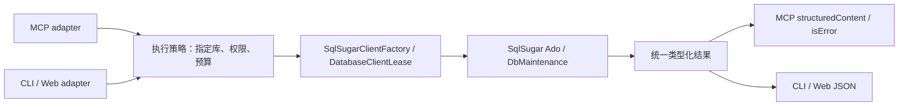

# 下一阶段 MCP 优化与升级计划

分析日期：2026-11-20。基线：`e70145b`。用户要求重新分析并结合 SqlSugar 等官方文档；分析阶段仅新增此计划，未修改业务代码或依赖，后续实施状态见下节。未使用子代理。

## 后续实施状态（2026-11-20）

用户已授权优化和依赖升级。已落实只读 PRAGMA / SELECT INTO 防护、数字往返精度、MCP isError、客户端自动取消回归，并升级 MCP 2.4.0 / SqlSugarCore 5.1.4.221 及兼容依赖；完整范围和验收证据见 [依赖升级说明](../Doc/dependency-upgrade.md)。下文仍保留分析时基线，类型化契约、默认预算、按请求指定数据库等后续阶段未混入本次变更。

## 已完成的基础与本轮证据

应保留：每租约独立 SqlSugarClient、IsAutoCloseConnection=true、驱动连接池、配置快照、并发准入、异步查询/普通命令、取消令牌透传、已验证的有界 JSON 输出和三种数据库集成脚本。

此前记录为 net9/net10 各 271 项常规测试通过、22 项显式启用的 provider 集成通过。本轮没有重新运行这些完整套件；对当前 Release 产物进行了临时 SQLite + 真实 MCP stdio 协议探测，协商版本为 2025-11-25。探测源码保留于忽略的 `.git/testagent/architecture-20261120/probe.py`；临时数据库和配置已清理。

| 发现 | 本轮实测或源码依据 | 优先级 |
| --- | --- | --- |
| 只读工具允许改变数据库状态 | `sql_query` 的 readOnlyHint=true；`PRAGMA user_version=2026` 返回成功，随后读到的值由 0 变为 2026。`SqlSafetyGuard.cs:11` 允许 PRAGMA，关键词检查不表达 provider 的副作用语义 | P0 |
| 极小数被静默转换为零 | 参数 `{"value":1e-50}` 执行 `select @value as number` 返回 `"0.0"`；独立 JsonElement.TryGetDecimal 返回 true、decimal=0，而 GetDouble=1e-50。见 `JsonElementValueConverter.cs:14` | P0 |
| 工具失败没有正确标记 MCP 错误 | 查询不存在表，JSON 内 success=false/errorCode=9999，但 CallToolResult 没有 isError=true；`McpToolBase` 捕获异常后返回普通字符串 | P1 |
| 查询结果无结构化契约 | `tools/list` 共 56 个工具；sql_query 无 outputSchema，调用无 structuredContent，parameters schema 为 string/null，模型需要生成嵌套 JSON 字符串 | P1 |
| 默认执行仍无输出上限 | `QueryTools.cs:34`：maxRows/maxResponseBytes 都为 null 时走 List<dynamic> 全量物化；single/scalar 也没有单值字节上限；完整多结果集仍 DataSet | P1 |
| 优化设置与真实生效范围不一致 | `MySqlOptimizationStrategy.cs:44` 起的 enableBulkCopy/maxPoolSize/charset/enableSsl 主要记录日志，factory 原样使用连接字符串。部分文档已称其为提示，需统一真实配置契约 | P1 |
| 多库目标依赖跨请求全局状态 | Query/Command 无 databaseName；AcquireClientAsync 捕获全局 current，SwitchDatabase 单独修改它。已入队请求快照安全，但“先切库、后查询”两次调用之间可被另一工作流切库 | P1 |
| 元数据与 provider 能力分散 | SchemaTools 表/列列表显式 isCache=false，综合 schema 又使用默认缓存行为；provider 类型判断、预设、策略及有限多结果集支持条件分散 | P2 |
| 缺少完整执行指标 | factory 仅配置 OnLogExecuting/OnError；Web durationMs/queueMs 不是跨 MCP/CLI/Web 的统一排队、SQL、读取、编码指标 | P2 |

`EnableDangerousOperations` 当前定义只约束通用命令中的危险 SQL，不是全局“只读角色”；专用 schema/SP 工具另有语义。不能仅更改该字段解释就声称完成授权控制。MCP 的 ReadOnly/Destructive 是提示，不能替代服务端权限与数据库账号权限。

## 目标结构

逐步让共享执行逻辑返回类型化结果，由各入口承担协议序列化；这可以减少字符串序列化再解析的重复工作。无需重建通用 ORM、Repository/UnitOfWork 大框架；现有 SqlSugar 生命周期与准入保持。

## 第一阶段：修复确定性缺陷与升级 MCP

### 1. 收紧只读边界

- 为 SQLite PRAGMA 区分只读查询和有副作用调用；不要简单禁止所有含等号的语句，因为部分只读 PRAGMA 也可接受参数。
- 为 PostgreSQL/SQL Server 的 SELECT INTO、MySQL INTO OUTFILE、带副作用的函数/EXPLAIN ANALYZE 等建立 provider 规则与明确边界。除 SQLite PRAGMA 外，这些是待验证项，不是本轮已复现结果。
- 提供独立的 read-only/read-write/schema-admin 工具暴露配置，并在执行层校验；只读部署使用真正受限的数据库账号。SQL 关键词判断不能证明任意函数无副作用。
- 保持 CLI/Web 现有确认机制；MCP 注解负责描述，执行策略负责授权。
- 验证：只读 PRAGMA 正常，写 PRAGMA 拒绝；数据库标记不变；各 provider 隔离实例验证已列副作用语句；现有合法 SQL/引号/注释仍兼容。

### 2. 数字精度与显式参数类型

- 首先修复 `TryGetDecimal` 成功但下溢/舍入的情况，规定可接受的数字精度策略；无法满足约定时明确返回 InvalidParameters，或按显式 Double 类型处理，不能静默改值。
- 回归边界：Int64 最小/最大、2^53+1、负极小数、1e-50、1e100、高精度 decimal、数组、NULL。
- 增量引入参数描述：name/value/dbType/direction/size，必要时 precision/scale；映射到 SqlSugar SugarParameter，保留旧 JSON 字符串入口。
- 这样可正确表达 PostgreSQL 的 typed NULL、时间/时区、decimal 和存储过程输出；旧 names-only 输出继续保留现有 provider 原值。
- SQL、IN、普通/批量命令和 SP 共用一处参数绑定。不要继续为每种工具维护独立转换分支。

### 3. MCP 结果与错误契约

- 业务失败映射为 CallToolResult.IsError=true；同时保留原 JSON errorCode/message，CLI/Web 行为先保持。
- 区分参数错误、数据库忙、命令超时、连接失败、SQL 执行失败和不支持能力；驱动 DbException 不再普遍归入 UnknownError。取消保持协议取消，不转成一般工具失败。
- 对成功结果提供显式 DTO + outputSchema + structuredContent；兼容客户端保留 text JSON，统计实际双份输出的传输字节，不能把原 payload 预算误当成整条 MCP 消息预算。
- 按 SDK 文档显式启用 UseStructuredContent，不能只给现有返回 JSON 字符串的函数加标记，否则结构化结果仍可能是字符串。
- 参数对象/数组的新入口采用真实 JSON schema，并兼容既有调用；避免一次性更改全部 56 个工具的名称与签名。
- 验证通过真实 SDK/stdio：正常、参数无效、数据库异常、预算截断、批量部分失败、取消、旧 CLI/Web payload、输出 schema 的一致性。批量部分失败明确标记 partial，不能盲目自动重试整个写批次。

### 4. MCP SDK 2.0.0 → 2.4.0

官方 2.4.0 release 包含 PR #1917：修复 stdio/stream/legacy SSE 中请求取消通知丢失和请求 ID 冲突导致取消被忽略。与本仓库上一轮“本地 token 取消未可靠触发远端结束”的现象直接相关，但需要本项目回归确认。

- 单独更新 MCP 依赖并核对 Microsoft.Extensions 依赖下限；2.4.0 元数据要求 Hosting.Abstractions/Caching.Abstractions >=10.0.14，当前直接 Microsoft.Extensions 包为 10.0.10。
- 增加“仅取消客户端 token、不手工发通知”的测试；确认服务端 token、数据库活动、队列名额全部恢复。
- 保留显式 notifications/cancelled 测试。测试默认协议与当前客户端兼容版本。
- 修复包含客户端代码：升级本服务依赖不代表外部 MCP 客户端也被升级，客户端发送行为需单独确认。
- 不把该 PR 的修复范围推广到所有 Streamable HTTP 场景；官方 PR 已说明范围限制。

## 第二阶段：执行成本与多库一致性

### 5. 默认预算与分页

- 增加服务端默认值和硬上限，工具参数只在授权范围内调整。候选初值：1000 行、1 MiB payload、30 秒命令超时；需按实际负载测量后确定，不能作为既有兼容值直接覆盖发布。
- 区分排队超时、连接打开超时、命令超时、请求截止时间。驱动不支持取消的路径如实暴露，不用 Task.Run/WaitAsync 伪装为数据库已停止。
- single/scalar/SP/schema 也需要字节限制；对单列大文本/LOB 的驱动物化与响应上限分别测量。
- 为简单 SELECT 提供可恢复分页，按官方 SqlQueryable + OrderBy + ToPageList/ToDataTablePage 实现，要求稳定排序；totalCount 可选，避免默认额外 COUNT。
- SqlSugar 官方明确 SqlQueryable 只适合简单 SQL；复杂 SQL/过程保留 Ado，不自动包裹改写任意 SQL。
- 有限多结果集逐 provider 验证类型映射、重复列名、空集合、NextResult 取消后再开放。当前三库“完整多结果集”通过，不等于有界 reader 映射已验证。
- 验证 1/8/32 路负载，记录 P50/P95、分配、峰值内存、数据库活动连接数、返回字节和取消完成时间。

### 6. 每次请求指定数据库

- 为查询/写入及 schema 查询增加可选 databaseName；缺省时兼容 currentDatabase。
- 在进入队列前原子捕获目标、权限、配置版本；添加 AcquireClientAsync(databaseName, token) 对应路径。
- 返回元数据注明执行的数据库及配置版本，使模型能够核对实际目标。
- 验证两个工作流交错切库与请求、排队期间 reload/rename，指定目标始终不变。
- 后续如果增加远程 Streamable HTTP，先完成身份与授权范围隔离；本地 Web 配置页面不是现有 MCP HTTP transport。

### 7. 让配置表示实际生效的行为

- 分清三类设置：SqlSugar ConnMoreSettings、驱动连接字符串参数、仅提示/未支持的选项。
- maxPoolSize 等通过对应驱动的 ConnectionStringBuilder 显式校验/配置，定义与用户连接字符串的优先级；TLS 选项不做隐式降低。
- enableBulkCopy 只有在工具实际调用 SqlSugar BulkCopy 时才可称为启用；当前普通 SQL ExecuteCommand 不会因该标记自动变成 bulk 路径。
- 增加脱敏的 effective configuration 诊断，未生效或未知选项明确提示，调整相关文档的“优化已应用”措辞。
- 以各 provider 的专用规则为依据，不把 MySQL 的连接池建议复制给所有国产库。

## 第三阶段：减少重复元数据查询并建立可测量基线

- **元数据**：统一表/列/索引 schema 获取与缓存策略；先依据官方 isCache 参数核对实际生命周期和失效行为。必要的应用级快照以连接身份、配置版本、schema/table 为 key，短 TTL、显式 refresh、DDL 后失效，合并并发相同请求。
- **MCP Resources**：把连接能力和 schema 摘要作为可选 resources/resources templates，保留工具入口。只包含脱敏元数据，支持按表获取，避免每次返回整个库结构。
- **Provider 能力表**：合并支持的 DbType/别名、驱动要求、已验证取消、有界多结果集、存储过程输出、schema 特性等事实；分别标记 supported/unsupported/unverified。该表是能力元数据，不替代 SqlSugar provider 实现。
- **指标**：在租约和执行边界统计 active/queued/rejected、queueMs/sqlMs/readMs/serializeMs/responseBytes、timeout/cancelled；SqlSugar OnLogExecuted + Ado.SqlExecutionTime 提供 SQL 阶段依据。使用 ILogger/ActivitySource/Meter，不向 stdio stdout 输出调试信息，不用完整 SQL/参数值作高基数指标标签。
- **旧入口**：公共 CreateClient/SqlSugarScope 兼容路径先标记迁移方向，不直接删除；新内部代码统一使用租约。当前工具主要走租约，收益应来自减少双轨维护和可测试性，而不是宣称既有工具正在泄漏。
- **发布验证**：对打包后的 global tool 做启动/stdio/CLI smoke，CI 使用可追溯镜像 digest；按配置需要评估 provider 预加载和依赖体积，再决定是否分可选包。

## 升级矩阵（本轮查询到的官方版本）

| 项目 | 当前 | 建议 | 依据与门槛 |
| --- | --- | --- | --- |
| .NET | net9.0 + net10.0，SDK global.json=10.0.201/latestFeature | 下一正式版本以 .NET 10 LTS 为主；SDK 验证后更新至 10.0.404；net9 仅做明确的过渡兼容 | 官方元数据 .NET9 support-phase=eol，2026-11-10 EOL；.NET10 EOL=2028-11-14。移除 TFM 会影响只有 net9 的用户，要通过发布说明管理 |
| ModelContextProtocol | 2.0.0 | 优先独立升级 2.4.0 | 2026-11-07 发布；stdio/stream 取消修复直接相关；检查依赖下限与协议兼容 |
| SqlSugarCore | 5.1.4.216 | 独立试升 5.1.4.221 | NuGet stable，2026-09-13 发布；package releaseNotes 为空，不能凭版本号声称性能提高。重跑三库 22 项及 SQLite/全部回归，并验证附加 provider 包 |
| MySqlConnector | 2.6.2 | 暂保留 2.6.2 | 已修复上一轮漏洞；3.0.0 是大版本，当前缺少必须升级的本项目证据，需独立兼容评估 |

不要在同一变更中同时重写执行架构、升级 SqlSugar 和驱动大版本，否则失败时难以归因。保持每阶段可独立验证、可独立回退。

## 建议执行顺序与回退

1. 先为已复现的只读副作用、1e-50 转换和 isError 缺失建立行为回归并修复。
2. 独立升级 MCP 2.4.0，验证自动取消传播与兼容版本。
3. 分离类型化结果与入口序列化；增量开放 typed parameters、默认预算、指定数据库。
4. 核对配置实际生效行为，建立指标；按测量结果推进 schema 缓存/分页/provider 能力表。
5. SqlSugar 5.1.4.221 和 .NET10 支持策略各自独立交付，发布前测试打包产物。

每一步保留工具名/旧输入格式、CLI 返回码、原有部分成功语义；权限与默认预算变更必须明确发布边界。没有新增跨调用事务状态；批量事务若后续需要，应在一个工具调用中用 SqlSugar UseTran/BeginTran，不能维持不受控的全局事务。

验证入口沿用现有解决方案和 `scripts/test-integration.ps1`；新增协议契约、只读账号、精度、配置优先级、两库交错、缓存失效等用例后分别执行。不要以旧测试数量代替本轮新行为的证明。

回退按独立提交/包版本进行；已发布工具的 schema 采用兼容入口或显式版本化。业务数据不参与测试迁移；测试只用临时 SQLite 或本任务 Docker 容器。权限保护已开启的部署不应通过回退默认设置重新开放写权限。

## 官方资料

- [SqlSugar ADO/参数/输出参数](https://www.donet5.com/Home/Doc?typeId=1198)
- [SqlSugar SQL 分页及适用范围](https://www.donet5.com/Home/Doc?typeId=1197)
- [SqlSugar 库表管理与 isCache](https://www.donet5.com/Home/Doc?typeId=1203)
- [SqlSugar AOP 与 SqlExecutionTime](https://www.donet5.com/Home/Doc?typeId=1204)
- [SqlSugar 生命周期](https://www.donet5.com/Home/Doc?typeId=1224)
- [MCP Tools 规范：结构化输出、错误、安全](https://modelcontextprotocol.io/specification/2026-07-28/server/tools)
- [C# SDK 工具文档](https://github.com/modelcontextprotocol/csharp-sdk/blob/main/docs/concepts/tools/tools.md)
- [MCP SDK 2.4.0 release](https://github.com/modelcontextprotocol/csharp-sdk/releases/tag/v2.4.0)
- [取消通知修复 PR #1917](https://github.com/modelcontextprotocol/csharp-sdk/pull/1917)
- [.NET 官方发布与支持元数据](https://builds.dotnet.microsoft.com/dotnet/release-metadata/releases-index.json)
- [.NET10 发布元数据](https://builds.dotnet.microsoft.com/dotnet/release-metadata/10.0/releases.json)
- [SqlSugarCore 5.1.4.221](https://www.nuget.org/packages/SqlSugarCore/5.1.4.221)
- [MySqlConnector 连接选项](https://mysqlconnector.net/connection-options/)
- [JsonElement.TryGetDecimal](https://learn.microsoft.com/en-us/dotnet/api/system.text.json.jsonelement.trygetdecimal?view=net-10.0)
- [SQLite PRAGMA user_version](https://www.sqlite.org/pragma.html#pragma_user_version)

文档获取说明：本轮 Context7 请求失败后直接读取官方站点、GitHub release/PR、NuGet 和 Microsoft 元数据；版本均核对实际发布时间。未把技能文件中的示例当作所有 SDK 版本都成立的实现事实。
