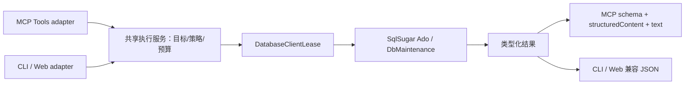

# MCP 依赖升级后的下一阶段实施计划

> 后续用户已授权取消非配置兼容承诺；对应旧接口保留条款由 [兼容清理计划](2026-11-20-remove-runtime-compatibility.md) 取代。下文保留原计划与当时验收记录。

分析日期：2026-11-20。基于当前工作区（含尚未提交的 MCP 2.4.0 / SqlSugarCore 5.1.4.221 升级）。本次仅审查代码、核对官方资料并新增计划，不改业务代码，不使用子代理。

上一轮已完成只读 PRAGMA/SELECT INTO 防护、数字精度、MCP isError、客户端自动取消验证，net9/net10 各 314 项常规测试及 25 项三库集成测试通过，并验证了安装后的 global tool。本轮没有重复运行测试或性能基准。以下是当前源码确认的设计缺口；未把潜在影响表述为已发生的生产事故。

## 建议决策

下一轮先交付“按请求指定数据库 + 可观测的查询预算”，随后交付 MCP 类型化契约，再处理配置、缓存和 provider 能力收敛。每阶段单独验收，保留现有独立 SqlSugarClient、IsAutoCloseConnection、驱动连接池和准入队列。

| 顺序 | 方向 | 当前依据 | 预期收益 / 影响面 |
| --- | --- | --- | --- |
| 1 / P1 | 每次请求明确数据库 | `DatabaseConfigService.cs:350` 异步租约只解析 current；`QueryTools`、`CommandTools` 缺少 databaseName | 避免切库与查询两次请求之间被其他工作流切换；中等改动，复用已有命名预留路径 |
| 2 / P1 | 服务端默认预算与硬上限 | `QueryTools.cs:46` 无参数走全量读取；`QueryReader.cs:33` 累积 List；`DatabaseExecutionOptions.cs:5` 只管理并发/排队 | 限制正常查询返回规模、内存占用和模型上下文消耗；兼容风险较高，分工具/provider 推进 |
| 3 / P1 | MCP 类型化参数/结果、错误分类 | `McpToolBase.cs:117` 在共享层转字符串；`CliToolInvoker.cs:65` 只支持 string/Task<string>；SP 输出参数只有名称 | 减少模型构造嵌套 JSON 字符串出错，表达 typed NULL/日期/输出参数，获得 outputSchema/structuredContent；影响多入口 |
| 4 / P1 | 配置真实生效与诊断 | `MySqlOptimizationStrategy.cs:44` 起部分选项只记录日志；factory `CreateConfig` 原样使用连接字符串 | 让配置含义可验证，减少“配置了但没作用”和 provider 差异；中等改动 |
| 5 / P2 | 元数据缓存、分页、能力表 | SchemaTools 表/列查询 false，而综合 schema 使用默认缓存；有界多结果集仅 SQLite | 减少重复 metadata 查询，减少模型试错，支持逐步读取；收益需先测量 |
| 6 / P2 | 发布与支持策略 | 当前保留 net9/net10；Mongo provider 本轮未做实库 CRUD；packageVersion 仍为 3.7.0 | 可复现发布，声明真实支持范围；按实际使用的 provider 扩大集成矩阵 |

## 第一阶段：请求目标与预算

### 范围与不变量

- `databaseName` 缺省沿用 currentDatabase；显式名称不存在时明确失败，不回退到默认库。
- 目标连接、权限、执行限制与配置版本在排队前原子捕获；队列中的请求不因切库/reload/rename 重新选目标。
- 显式 databaseName 请求不改变全局当前库、持久化选择或 Web 当前连接。
- 继续在 reader/数据库执行实际结束后释放租约；不能使用 Task.Run/WaitAsync 宣称同步数据库工作已经停止。
- 无新增跨调用事务状态，无自动重试写批次。

### 实施清单

- [ ] 在 `IDatabaseConfigService` / `DatabaseConfigService` 增加命名异步租约重载，复用 `ReserveClient(databaseName)`。
- [ ] 将 `McpToolBase` 的请求上下文扩展为包含目标身份和实际配置版本；先给 Query/Command 增加可选 databaseName，随后覆盖 schema。不要请求结束后再读取全局 current 充当执行目标。
- [ ] 在 `SqlSugarClientFactory` 准入边界记录 active/queued/rejected/queueMs，在执行及序列化边界记录耗时和输出字节。SQL 时长可用官方 OnLogExecuted / SqlExecutionTime，但不能代替完整读取、序列化及排队时长。
- [ ] 在 `DatabaseExecutionOptions` 增加可配置默认值和硬上限，定义服务端策略优先于调用方参数。先覆盖普通/IN/batch 查询。
- [ ] 候选值为 1000 行、1 MiB 工具 JSON、30 秒命令超时；先测量并作为可启用配置，正式改变缺省行为时写明发布边界。无限超时/无界输出只能在明确服务端策略允许时使用。
- [ ] 为 single/scalar 单独定义单值限制；有界 reader 也可能先将单个 LOB 读入内存，所以输出字节限制不能宣称为进程峰值内存上限。大字段需要单独验证 GetValue/映射行为，再决定 provider 原生分段读取。
- [ ] `get_data_set_all` 暂按能力分支处理；当前 `BoundedQueryExecutor.MultipleAsync` 在非 SQLite 上明确拒绝。先实现/验证三库等价类型映射，再统一缺省限制，避免默认参数让原本支持的三库调用失败。

### 验收

两个独立数据库使用不同标记数据；交错执行 switch/query、显式命名 query/write，并覆盖排队时 reload/rename、目标不存在、取消、队满。确认读写只到预期库，返回目标与快照一致。

预算覆盖未传参数、恰好边界、超过边界、单个大字段、中文 UTF-8、批量共享预算、部分失败及取消。保持不为判断是否截断而额外读取第 N+1 行的已有行为。测量并发 1/8/32 下 P50/P95、分配量/峰值内存、数据库活动连接数和取消结束时间；不预设性能百分比。

## 第二阶段：MCP 契约与参数绑定

- [ ] 先提取查询执行用例和结果 DTO，保持 SqlSugar 负责数据库操作；避免将所有工具一次性改写或增加通用 ORM 框架。
- [ ] 先适配 `CliToolInvoker` / Web 调用结果，再让 MCP 工具返回 DTO 或 CallToolResult。旧入口保留原字段、错误码、退出码和批量部分成功含义。
- [ ] 使用 SDK 官方 UseStructuredContent 配置并校验实际 outputSchema；动态列的行数据以 object/additionalProperties 表达，外层行数/限制/目标/错误字段明确类型。
- [ ] 同时返回 text 与 structuredContent 时测量实际 JSON-RPC 字节。现有 maxResponseBytes 只约束工具 JSON；不能把这个数直接当作整个协议消息大小。
- [ ] 增加明确 schema 的参数描述：name/value/dbType/direction/size，precision/scale 以实际 SugarParameter API和驱动能力为准；统一映射绑定，旧 JSON 字符串继续支持。两种输入同时出现时拒绝歧义，不隐式合并。
- [ ] 三库验证 typed NULL、Int64、decimal、DateTime/DateTimeOffset、数组、Input/Output/InputOutput；拒绝 provider 不支持的组合，不猜测参数类型。
- [ ] 细分 InvalidParameters、DatabaseBusy、连接失败、命令超时、执行失败和不支持能力。当前直接 JSON 解析错误仍可能落入 UnknownError；不要依赖英文异常 message 判断所有 provider 错误。
- [ ] 将允许调用的能力与工具展示配置分开：read-only/read-write/schema-admin 等能力须由 MCP/CLI/Web 的共同执行层验证；隐藏工具不等于阻止直接 tools/call。沿用现有 enableDangerousOperations 含义，通过新策略明确迁移，不改名即改变权限。

验收使用真实 SDK/stdio：旧工具调用、JSON 参数兼容、新参数 schema、输出 schema 与 payload 一致、合法空结果、无效参数、超时、数据库异常、部分成功和取消。SQL 只读语法检查不能覆盖任意用户函数，账号权限仍负责数据库授权。

## 第三阶段：配置、元数据和能力收敛

- [ ] `optimizationSettings` 分类为 SqlSugar ConnMoreSettings、驱动连接选项和建议项；已有“仅提示”的键先显示 ignored/advisory，避免升级后悄悄改变 TLS/连接行为。
- [ ] 实际连接选项通过驱动 ConnectionStringBuilder 校验；定义显式连接字符串优先等唯一规则，脱敏诊断报告 configured/effective/source。enableBulkCopy 只有实际采用 SqlSugar BulkCopy 路径时才可称为执行能力。
- [ ] 统一 schema 获取服务，先确认官方 isCache 的生命周期、key 与失效方式，避免盲目叠加两层缓存。若增加应用级缓存，key 包含连接稳定身份、配置版本、schema/table；有容量上限、TTL、refresh、DDL 成功失效和同一查询并发合并。
- [ ] 优先按需提供 schema 摘要与单表详情。MCP resources 是可选适配，需实际客户端读取它才有收益，不假定所有客户端自动消费。
- [ ] Provider 能力表分别记录 supported / unsupported / unverified，汇总取消、有界多结果集、存储过程、schema 特性；继续由 SqlSugar 实现方言与驱动访问。
- [ ] 简单 SQL 分页按官方 SqlQueryable + 外部 OrderBy + ToPageList/ToDataTablePage；要求稳定唯一排序，不默认额外执行 COUNT。并发写入下分页一致性需单独定义；复杂 SQL/过程仍使用 Ado，不能自动包裹任意 SQL。
- [ ] 在确认兼容调用方后逐步弃用共享 CreateClient/SqlSugarScope 双轨入口。先处理生命周期/文档不一致，不宣称当前主要工具都在复用共享上下文。

验收：连接参数冲突、无效值、未生效选项、TLS 优先级；并发 schema 请求、TTL、DDL/reload/rename 失效，缓存不会跨库；分页重复/缺失与错误排序，provider 未支持能力明确返回。

## 发布、回退与依赖策略

1. 当前 MCP/SqlSugar 升级先作为独立已验证基线保留；无需为了版本号继续同时引入 .NET 11、MySqlConnector 3 等大版本。
2. 新部署以 .NET 10 LTS 为主；.NET 9 已结束支持，移除 net9 TFM 应在后续发布说明中单独声明。正式发布时同步 csproj、`.mcp/server.json`、README 和发布标签版本。
3. 将已做过的 pack → 本地安装 → CLI/stdio smoke 固化到 CI；依赖漏洞审计和既有三库测试保留。按用户实际使用补 MongoDB 实库回归，再扩其他 provider，避免只凭编译宣称全面支持。
4. 每阶段独立提交/包版本及回归记录。新增请求目标先可选；预算默认变更用可配置策略渐进启用；类型化接口保留旧入口；缓存可关闭/刷新。权限开启后回退不能重新开放此前禁止的写入。
5. 继续执行现有 `scripts/test-integration.ps1` 和协议兼容测试；本计划列出的新行为必须增加相应断言，不能只复用上轮通过数量作验收依据。

## 本次核对的官方资料

- [MCP SDK 2.4.0 tools](https://github.com/modelcontextprotocol/csharp-sdk/blob/v2.4.0/docs/concepts/tools/tools.md)：UseStructuredContent、输出 schema 和直接序列化返回值。
- [SqlSugar ADO](https://www.donet5.com/Home/Doc?typeId=1198)：SugarParameter、DbType、Direction 和存储过程输出参数。
- [SqlSugar SQL 分页](https://www.donet5.com/Home/Doc?typeId=1197)：仅简单 SQL，OrderBy 外置，复杂 SQL 使用 Ado。
- [SqlSugar 库表管理](https://www.donet5.com/Home/Doc?typeId=1203)：isCache=true/false 的明确语义。
- [SqlSugar AOP](https://www.donet5.com/Home/Doc?typeId=1204)：OnLogExecuted / SqlExecutionTime，不向 MCP stdout 输出。

以上网页本轮已直接读取。依赖版本与上轮真实测试记录见 `Doc/dependency-upgrade.md`。

## 2026-11-20 实施结果

用户已授权执行本计划，当前工作树新增以下实现，原依赖升级暂存区保持不变：

- [x] 命名异步租约；Query/Command/Schema 可选 databaseName；排队前版本/权限快照；显式请求不切全局库。
- [x] 查询执行预算、默认与硬上限、single/scalar 字节限制、同步过程响应限制；四库有界多结果集。
- [x] 准入、排队、SQL、读取、请求、序列化和响应字节 Meter；本机并发 1/8/32 基准记录。
- [x] `query_database` 类型化服务/DTO、outputSchema、text/structuredContent；CLI/Web 适配；实测 stdio 字节。
- [x] typed NULL、数值、日期、数组、输出/InputOutput；按实际 SugarParameter 能力拒绝输出 precision；错误码和共享权限检查。
- [x] `get_database_capabilities` 能力/有效选项/来源诊断；旧 MySQL 建议项标记 advisory，不改变 TLS 或连接参数。
- [x] schema 有限缓存、TTL、refresh、并发合并、DDL/失败失效、连接重命名稳定身份；按主键的 `query_table_page`，不 COUNT。
- [x] 保留兼容 API，修正文档；本地包安装/stdio 验证脚本与 CI 集成；三库/双 TFM 回归。

条件性项目仍按原计划边界保留：MCP resources 等待实际客户端需求；MongoDB 实库测试待选定工作负载；不移除 net9/旧 CreateClient、不发布正式版本、不新增 BulkCopy 执行路径。本轮分页/过程仍可由驱动物化大字段，不宣称峰值内存硬限制；生产容量和跨页快照另行评估。

实施说明与验收记录见 [数据库 MCP 工作流](../Doc/database-mcp-workflow.md) 和 [执行测量](../Doc/execution-optimization.md)。
