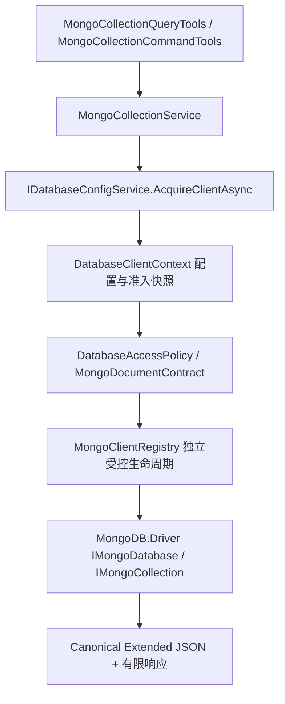

# MongoDB 集合查询与写入契约实施计划

日期：2026-11-20。状态：已实施并完成验证。全程不使用子代理。实现与验收见 [MongoDB 集合契约](../Doc/mongodb-collections.md)。

本任务跨越客户端生命周期、写入权限、BSON、MCP/CLI/Web 参数契约和集成测试，首次按 AGENTS.md 交付计划，后经用户“按计划实现”授权执行。起始工作区已有 65 个暂存文件及上一轮未暂存修改；不得 reset、覆盖、重新暂存或提交这些内容。

## 目标与范围

提供明确的集合发现、文档查询、计数、插入、更新和删除工具。Agent 从 tools/list 得到当前契约；不添加旧名称、旧字符串命令或 SQL 模拟兼容接口。保留配置格式和配置别名的兼容性。

第一版新增六个工具，总工具数从 56 变为 62。聚合管道、任意 runCommand、数据库/集合删除、索引管理、批量插入、多文档事务和 change stream 不在这一版范围。这些功能需要独立权限与结果契约，不能隐含在通用参数中。

源码和测试继续 net9.0/net10.0；发布包仅 net10.0，保留上一轮包大小限制。

## 已核实的事实与实现选择

当前实际依赖为 SqlSugarCore 5.1.4.221、SqlSugar.MongoDbCore 5.1.4.280、MongoDB.Driver/Bson 3.11.1、MCP 2.4.0。无需为了此功能顺带升级其他依赖。

SqlSugar 官方 MongoDB 文档的“获取原生对象”提供：

```csharp
IMongoDatabase database = ((MongoDbConnection)db.Ado.Connection).GetDatabase();
```

但对当前安装包 MongoDb.Ado.Data.dll 的实际核查发现：

1. MongoDb.Ado.data.MongoDbConnection 的静态客户端缓存使用 `Dictionary<string, MongoClient>(StringComparer.OrdinalIgnoreCase)`，凭据及库名大小写变化可能命中原客户端。
2. 解析入口只识别 `mongodb://`，`mongodb+srv://` 会走键值连接串分支。
3. 缓存首次读取在锁外，且没有配置移除和客户端资源回收机制。

因此本轮集合执行使用已安装的官方 MongoDB.Driver 原生 API，保留现有 SqlSugar 租约提供的准入、目标和配置快照。集合执行路径不访问 `context.Client.Ado.Connection`，避免触发上述缓存；也不把 `db.collection.find(...)` 拼成 ADO 命令字符串。此选择与官方推荐原生 API 的方向一致，但有意绕开当前扩展的具体连接实现缺陷。

直接使用 MongoDB.Driver 后在 csproj 显式声明现有版本 3.11.1，避免依赖仅由 SqlSugar 的传递引用决定。BSON 转换使用同版本官方 serializer，不自行模拟 BSON。



## 不变量

- 每次调用只绑定一个连接快照；连接名省略时使用排队前捕获的当前库；调用期间不更改全局当前库。
- Mongo 工具在关系型连接上返回 1012；已有 SQL 工具在 Mongo 上继续返回 1012，不放松 SQL 安全校验。
- 权限取服务器 `DB_TOOL_ACCESS` 和连接 `accessMode` 中更严格的一方。检查发生在网络或写入之前。
- 配置诊断和 capabilities 不建立 MongoClient、不解析 SRV DNS、不做 ping。
- 所有数据库操作必须接收 CancellationToken，使用服务端策略限定的超时；不以 `Task.WhenAny` 提前返回后遗留后台写入。
- 文档值、连接字符串、凭据和原始 Mongo 异常消息不得进入错误响应或普通日志。
- 不宣称多文档写原子性，也不把超时、取消后的未知写入结果标为“未执行”。

## 工具参数契约

六个工具均支持 `databaseName` 和 `commandTimeoutSeconds`，查询类支持 `maxResponseBytes`。超时默认采用现有 bounded query 策略；0 仅在服务器允许无限等待时有效。

| 工具 | 参数要点 | 输出与权限 |
| --- | --- | --- |
| `mongo_list_collections` | 可选 `namePrefix`；`maxRows` | name/type 列表，Read；不执行任意集合过滤表达式 |
| `mongo_find` | `collection`；可选对象 `filter`、`projection`、`sort`；`skip=0`；`maxRows` | 有限文档列表，Read；默认 `_id:1` 排序，用户排序补 `_id` 作为末尾唯一排序键 |
| `mongo_count` | `collection`；可选对象 `filter` | 精确 matchedCount，Read；不在 find 中隐式执行 count |
| `mongo_insert_one` | `collection`；必填对象 `document` | acknowledged、insertedId，Write；缺省 `_id` 由客户端生成 ObjectId |
| `mongo_update` | `collection`；必填对象 `filter`、`update`；`many=false`、`upsert=false`、`allowAll=false` | matchedCount、modifiedCount、upsertedId，Write；默认 UpdateOne |
| `mongo_delete` | `collection`；必填对象 `filter`；`many=false`、`allowAll=false` | deletedCount，Write；默认 DeleteOne |

MCP 参数为真实 JSON 对象（`Dictionary<string, JsonElement>` 或等价的明确 object schema），不是 JSON 文本套字符串。CLI 仍通过 `--filter '{...}'` 输入，由统一 binder 解析成对象；Web 使用已有 JSON 输入组件。禁止接受数组、标量、JSON null 代替必填对象。

示例：

```json
{
  "name": "mongo_find",
  "arguments": {
    "databaseName": "mongo-app",
    "collection": "orders",
    "filter": {"customerId": {"$oid": "507f1f77bcf86cd799439011"}},
    "projection": {"customerId": 1, "total": 1},
    "sort": {"_id": 1},
    "maxRows": 20
  }
}
```

## BSON 与输入校验

- 接受严格 JSON 和 Extended JSON v2；ObjectId、Int64、Decimal128、UTC 日期、二进制/UUID 用官方 `$oid/$numberLong/$numberDecimal/$date/$binary` 形式表达。
- 输出文档及 ID 固定 Canonical Extended JSON v2；普通 envelope 字段仍为常规 JSON。字符串 `_id` 保持字符串，24 位十六进制字符串不自动变成 ObjectId。
- 拒绝重复 JSON 字段、超深对象（64 层）、非法 EJSON 包装及不支持的 JavaScript BSON 类型。整个输入上限 4 MiB；单文档 BSON 仍不得超过服务器 16 MiB 限制。
- 字段名保留业务大小写；集合名不套 SQL identifier 正则，按 Mongo 名称规则验证，并禁止 `system.*`、NUL、`$` 和空名称。
- 过滤器递归拒绝 `$where`、`$function`、`$accumulator` 及 BSON JavaScript。其余合法查询操作符交给 MongoDB 验证；不声称此检查是完整 Mongo 语法解析器。
- projection 第一版只开放 0/1 字段包含/排除，保留 `_id` 特例，拒绝非法混用；sort 第一版只接受 1/-1，不接受 `$meta`。
- skip 限制为 0–100000，并说明深分页成本、并发写入会移动分页结果，不承诺跨请求快照。
- update 必须是非空操作符文档，第一版白名单 `$set`、`$unset`、`$inc`、`$mul`、`$min`、`$max`、`$push`、`$pull`、`$addToSet`、`$pop`、`$currentDate`、`$setOnInsert`；不支持 replacement 或数组形式的 update pipeline。
- 禁止更新 `_id` 及 `_id.*`；避免误把嵌套 `$set` 数据当作命令。操作符值必须符合其对象结构，服务器负责字段类型/冲突的最终验证。

## 写入保护和结果语义

- 三个写工具加入 `CliWriteProtection`；CLI 需要 `--yes`，Web 需要输入工具名称确认；MCP 标注 Destructive，不依赖注解代替服务端权限。
- `many=true` 必须有 `enableDangerousOperations=true`，即使 filter 非空也一样。`many=true && upsert=true` 第一版拒绝，减少批量插入语义歧义。
- update/delete 的空对象 filter 必须同时有 `allowAll=true` 和 `enableDangerousOperations=true`；未提供 filter 与显式 `{}` 区分。非空过滤器也可能覆盖全库，文档明确其限制，默认 one 仍是主要保护。
- `w=0` 写入在执行前拒绝，保证计数和 acknowledged 可解释；不静默改写用户 write concern。
- 写入请求成功时只返回小型确认，不回传完整文档。insert 的 ID 在写入前生成并检查响应预算，避免“成功写入后才因 ID 太大报预算错误”。
- write response 包含 `writeOutcome`：`acknowledged`、`not-executed`、`unknown`。many 超时可能部分生效；不能把 modifiedCount=0 当作失败；匹配 0 条正常成功。
- 客户端取消继续传播为协议取消；文档说明取消不回滚已经提交的写入。禁止应用层自动重试写操作；驱动 retryWrites 沿用连接配置。

## 有限查询、超时和错误

- 查询用 `FindAsync` / cursor `MoveNextAsync`，不先 `ToListAsync` 全量加载再裁剪。BatchSize 最多 64，服务端 Limit 与 `maxRows` 一致。
- 按 Canonical EJSON 实际 UTF-8 编码累计文档字节，并计入整个工具 envelope；与已有 SQL 一样，不把传输 text/structuredContent 重复部分算入工具预算。
- 行数触顶返回 `limitReached=true, truncated=null`，不额外读第 N+1 条证明尾部；实际遇到超字节文档返回 `truncated=true`。首条过大不能伪装成没有匹配结果，必须带清晰限制状态。
- cursor 在正常结束、超限、异常、超时、取消路径均 Dispose；最终响应 text 与 structuredContent 完全一致。
- 实施时通过编译与反编译纠正前期 XML 核查：Driver 3.11.1 操作级 Timeout 实际为 internal。使用贯穿准入、DNS、命令及 cursor 生命周期的共享 CancellationToken 截止时间，find/count 同时使用公开 MaxTime，不使用反射或每批重新计时。SRV 显式调用 ResolveAsync(bool, token)，绕开该版本 token-only 重载未传 token 的问题。
- 保留请求取消与服务器超时区别。认证/网络失败映射 1001，参数校验 1004，权限 1010，超时 1011，provider 不支持 1012，响应限制 1013；写入/查询服务器错误使用 1002，必要时附安全的 Mongo 数字代码，不回显 duplicate-key 的键值。

## 客户端生命周期与配置

新增 singleton `MongoClientRegistry`，对相同配置长期复用线程安全 MongoClient；不每次调用 new MongoClient。

- 从现有租约 context 中读取不可变连接快照；匹配键使用 Ordinal 或其不可逆摘要，不能 IgnoreCase，不能把凭据用作可见 telemetry 标签。
- Registry 与准入租约相互独立：原租约管理并发槽位，Mongo registry lease 管理客户端引用计数。身份包括连接身份及精确连接配置，避免重命名/同名替换串库。
- 同连接新配置创建新 client；旧 client 在最后一个在途 Mongo lease 释放后 Dispose。排队中的旧版本快照仍按原配置执行，不被强制改成新配置。
- 空闲项有明确容量上限（初始 128）及淘汰策略；在途 client 不淘汰；全部在途且满额时返回 DatabaseBusy。宿主退出释放剩余 client，不记录连接串。
- 连接 URI 必须显式包含实际数据库名；`authSource` 不能代替数据库选择，不采用 `SqlSugarDefaultDB` 等静默缺省库。此要求在新 Mongo 工具入口校验，保留已有配置导入规则。
- 保留 `mongodb://` 和 `mongodb+srv://` 原样交给官方驱动。原生客户端构建可能触发 DNS，必须在权限校验之后；实现时验证 SRV 初始化的实际取消/超时边界，不宣称离线校验验证了 DNS。
- Mongo 的 `test_connection`、`test_connection_by_name`、CLI doctor 在线检测应改走同一原生路径执行 ping，防止“集合工具可用、连接检测仍走旧错误解析”。配置、capabilities 离线流程保持不触网。查找所有连接检测调用点后统一接入，不能只修两个工具。

## 预计文件与职责

| 路径 | 变更 |
| --- | --- |
| `Models/MongoCollectionResult.cs` | 查询、计数和写确认 DTO，明确 EJSON 与 writeOutcome |
| `Helpers/MongoDocumentContract.cs` | 对象/EJSON 转换、集合/过滤/更新/投影校验 |
| `Services/MongoClientRegistry.cs` | 原生 client 复用、隔离和释放 |
| `Services/MongoCollectionService.cs` | 租约、权限、预算、原生操作及 cursor 生命周期 |
| `Tools/Query/MongoCollectionQueryTools.cs` | list/find/count，结构化输出及 MCP 注解 |
| `Tools/Command/MongoCollectionCommandTools.cs` | insert/update/delete，写确认和错误状态 |
| `Extensions/DatabaseMcpToolCatalog.cs`、`ServiceCollectionExtensions.cs` | 显式 WithTools 注册和 DI；CLI/Web 共享同一目录 |
| `Cli/CliToolMetadata.cs`、`CliToolInvoker.cs`、`Web/CliWebToolService.cs` | 明确支持对象 JSON 参数，保留数组工具的现有行为 |
| `Cli/CliWriteProtection.cs` | 新增三个写工具的已有确认机制 |
| `Helpers/DatabaseCapabilities.cs`、`DatabaseProviderCatalog.cs` | Mongo 集合能力、SQL 不适用说明；能力按实测标记 |
| `Tools/Management/ConnectionTools.cs` 及现有连接检测服务 | Mongo 在线检测统一原生 ping；离线流程不变 |
| `Filters/McpExceptionFilter.cs` 或专用 Mongo 错误 helper | 保留现有 SQL 分类，新增脱敏 Mongo 分类 |
| `src/DatabaseMcpServer/DatabaseMcpServer.csproj` | 明确 Driver 依赖、打包新增契约文档 |

上表简写路径均相对于 `src/DatabaseMcpServer/`，除 csproj 已给出完整相对路径。如果对象元数据能直接复用已有 JSON textarea，就不修改 Vue；若必须改 Vue，执行阶段再读取 Vue 技能。

## 实施顺序

- [x] 保存当前 staged/unstaged 状态清单，只在工作区叠加本功能。
- [x] 定义六工具、DTO、EJSON 与校验；只读/参数行为回归不连接数据库。
- [x] 实现原生 registry 和生命周期测试，验证不同大小写凭据不能复用、热更新在途隔离及回收。
- [x] 实现 bounded list/find/count、统一 Mongo ping，验证权限先于 DNS/网络。
- [x] 实现单文档插入及 one/many 更新删除、空 filter 防护、acknowledgment 和未知结果语义。
- [x] 注册 MCP/CLI/Web 和 JSON 对象绑定，新增写确认；验证实际 tools/list、输出 schema、错误 isError。
- [x] 新增独立 Mongo Docker 集成脚本：MongoDB 8.0 镜像并记录 digest、随机凭据、loopback 随机端口、测试 run 标签、finally 清理；只操作本轮容器。
- [x] 更新 `DatabaseSetting/MongoDB.md`、`Doc/mongodb-collections.md`、`TOOLS.md`、中英文 README、`Doc/orm-configuration.md`、当前驱动说明及 `.mcp/server.json`，删除当前“集合工具未实现”声明；历史审计仅补后续链接。
- [x] 更新 `scripts/test-package.py`、`scripts/verify-cli-tools.ps1` 和硬编码工具数。SQLite CLI 覆盖中新 Mongo 工具明确为 provider 不支持；Mongo 集成验证其成功路径。
- [x] 运行定向测试、双框架回归、Mongo 实库和已有三库回归、pack/install/stdio、依赖审计；完成结果记录。

## 验证矩阵

下列为计划测试名，不是已通过的测试。

| 行为 | 计划验证 |
| --- | --- |
| EJSON 类型及值不丢失 | `CanonicalExtendedJson_RoundTripsBsonTypes`：ObjectId、字符串 ID、9007199254740993、Decimal128、日期、binary/UUID、嵌套数组和 null |
| 非法/危险输入不触库 | `InvalidDocuments_AreRejectedBeforeClientCreation`：数组/标量、重复字段、深度/大小、JS 类型、非法更新/投影/排序 |
| 两层权限和读写确认 | `ReadOnlyPolicy_BlocksEveryMongoWrite`、`MongoWrites_RequireCliAndWebConfirmation` |
| 大范围修改保护 | `ManyAndEmptyFilter_RequireExplicitDangerousOptIn`：one/many、empty/nonempty、allowAll、连接开关的组合 |
| client/配置隔离 | `ClientRegistry_PreservesCaseSensitiveCredentials`、`Reload_KeepsInflightMongoSnapshotAndRetiresOldClient`、`ClientRegistry_BoundsIdleEntriesAndDisposesOwnedClients` |
| 真实 CRUD | `CollectionTools_RoundTripInsertFindUpdateDelete`；matched=0、matched>0/modified=0、upsert ID、one 只影响一条、many 返回真实计数 |
| 限流和释放 | `Find_EnforcesRowsBytesAndDisposesCursor`：恰好达到/超过行数、首条超大、多批、取消、异常后继续查询 |
| 超时和未知写入 | `MongoTimeout_IsNotReportedAsClientCancellation`、`WriteFailure_DoesNotClaimRollback`；网络中断/服务器故障注入不能依赖 sleep 猜测 |
| 安全错误 | `MongoErrors_DoNotExposeUriOrDocumentValues`，含认证失败和 duplicate-key |
| 原生 URI 和实库 ping | `MongoConnectionCheck_UsesConfiguredDatabaseAndNativeDriver`；SRV 解析路由可离线验证，但真实 SRV DNS/TLS 如未提供环境须单独标注 |
| 真实 MCP/CLI/Web | `MongoTools_PublishObjectSchemasAndStructuredResults`，62 个工具、新工具唯一注册、text/structured 相同、非 Mongo 返回 1012 |

验证命令（新增脚本实施后才存在）：

```powershell
dotnet test 'DatabaseMcpServer.slnx' -c 'Release' --filter 'FullyQualifiedName~Mongo'
dotnet test 'DatabaseMcpServer.slnx' -c 'Release' --filter 'Category!=Integration&Category!=MongoIntegration'
pwsh -NoProfile -File 'scripts/test-mongodb-integration.ps1'
pwsh -NoProfile -File 'scripts/test-integration.ps1'
pwsh -NoProfile -File 'scripts/test-package.ps1'
pwsh -NoProfile -File 'scripts/verify-cli-tools.ps1' -Framework 'net10.0' -Configuration 'Release'
dotnet list 'DatabaseMcpServer.slnx' package --vulnerable --include-transitive
```

Mongo 集成需独立 opt-in 环境变量（如 `DBMCP_RUN_MONGODB_INTEGRATION=1`、`DBMCP_TEST_MONGODB`），避免现有三库脚本设置 `DBMCP_RUN_INTEGRATION` 后误跑缺环境的 Mongo 测试。脚本必须检查 TRX 全部执行、零失败、零跳过。MongoDB standalone 足以验证本轮非事务 CRUD；不能将其外推为副本集事务验收。

## 回退

仅撤销本功能新增文件和在既有文件中的对应 hunks；不使用 git reset/restore 清理其他工作。移除新增六工具注册及 registry 后恢复 Mongo 集合 unsupported 状态，保留前一轮驱动补齐、net10 发布、现有 SQL 权限和配置兼容。所有测试写入限定临时数据库/容器；无生产迁移或数据修复步骤。

## 资料与证据

- [SqlSugar 官方 MongoDB 接入、原生对象与事务要求](https://www.donet5.com/Doc/1/2651)。
- [MongoDB 官方 C# 客户端生命周期](https://www.mongodb.com/docs/drivers/csharp/current/connect/mongoclient/)。
- [MongoDB 官方 C# 查询与 cursor](https://www.mongodb.com/docs/drivers/csharp/current/crud/query/find/)。
- [MongoDB 官方 C# 更新及 acknowledged/matched/modified/upsert](https://www.mongodb.com/docs/drivers/csharp/current/crud/update-one/)。
- [MongoDB 官方 Extended JSON v2](https://www.mongodb.com/docs/manual/reference/mongodb-extended-json/)。
- [C# Driver Extended JSON](https://www.mongodb.com/docs/drivers/csharp/current/document-formats/extended-json/)。
- 当前包 XML 与 DLL 反编译确认 MongoClient.Dispose、内部 Timeout 属性及 SqlSugar bridge 的缓存和 URI 解析行为。核查副本保存在 `.git/mongodb-contract/`，不进入提交。

实现与验证已完成，实际记录以 [集合契约文档](../Doc/mongodb-collections.md) 验收节为准。双框架非远程回归各 435 passed，Mongo 实库各 10 passed，三库回归各 38 passed；均零失败、零跳过。62/62 CLI 覆盖，net10 安装包 149.2 MiB，依赖审计无已知漏洞；初始暂存补丁 SHA-256 保持一致。
